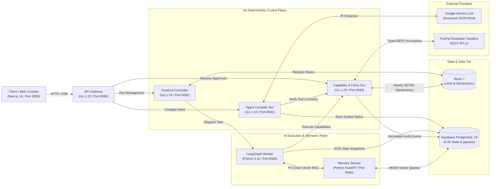

# DelTix

Geo-Distributed Financial AI Agent Compiler and Stateful Runtime Platform with Closed-World Capability Binding, Externalized Go Policy Guardrails, and Idempotent PayPal Sandbox Execution.

Target Track: PayPal AI Hackathon (Agentic Commerce / Best Use of PayPal + AI)

---

## 1. Executive Summary

Traditional LLM agent implementations in financial workflows are inherently fragile and regulatory-hazardous:

- **Unbounded Tool Invocations and Hallucinated APIs:** Probabilistic foundation models frequently invent non-existent REST endpoints, pass malformed payload schemas, or execute unauthorized mutations without deterministic validation.
- **In-Prompt Security Bypasses:** Natural language constraints (such as *"do not refund more than $50"*) placed inside system prompts are vulnerable to prompt injection, jailbreaks, and semantic drift. Financial security boundaries must be enforced outside the model.
- **Double-Charging from Network Retries:** In distributed financial systems, retrying a timed-out mutation without strict idempotency headers causes duplicate payouts or multiple unauthorized refunds.
- **IEEE-754 Floating-Point Drift:** Native binary floating-point calculations accumulate rounding errors across multi-step transactions, introducing ledger discrepancies and balance-sheet drift.
- **State Loss During Human-in-the-Loop Reviews:** Pausing an in-flight execution for human operator sign-off typically requires blocking worker process memory. Process restarts or server crashes permanently destroy active execution context.

DelTix resolves these systemic failures through a purpose-built compiler and stateful runtime architecture:

- **Go 1.23 Deterministic Control Plane:** Externalized policy enforcement, capability resolution, and Redis Redsync distributed mutual exclusion executed strictly outside the LLM.
- **Declarative Agent IR v1.0:** Natural language prompts compile into a versioned, strongly typed Intermediate Representation validated against JSON Schema and directed acyclic graph (DAG) topology rules.
- **Python 3.11 LangGraph State Machine:** Checkpointed, resumable execution engine that pauses cleanly during human approval gates, releases worker locks, and resumes mid-graph from persistent Supabase PostgreSQL 16 state.
- **Exact Python Decimal AST Evaluator:** Financial arithmetic is parsed into abstract syntax trees and evaluated using base-10 decimal representations to eliminate floating-point drift.
- **Idempotent PayPal Developer Sandbox Adapters:** Typed Go adapters enforcing SHA-256 `PayPal-Request-Id` keys and circuit-breaker fault tolerance.

---

## 2. System Architecture

The following diagram illustrates the end-to-end data pipeline from user prompt ingestion, through the Go control plane and compilation pipeline, to the stateful LangGraph runtime and PayPal Developer Sandbox:



---

## 3. Core Architectural Pillars

### Pillar 1: Closed-World Capability Registry and Externalized Policy Guard

Traditional agent frameworks grant models open-ended network access or loosely typed tool schemas. In DelTix:

1. **Closed-World Catalog:** Agent nodes bind exclusively to verified capabilities declared in `capability_registry` (e.g. `paypal_get_capture`, `paypal_refund_capture`, `paypal_create_payout`). Undeclared tool calls are rejected at compile time.
2. **Externalized Go Policy Interceptor:** Spending limits (such as a $500.00 run budget) and approval thresholds ($50.00) are evaluated inside the Go `Capability & Policy Service` before any outbound HTTP dispatch.
3. **Prompt Injection Immunity:** Even if an adversarial prompt succeeds in manipulating the LLM output, the Go control plane intercepts the mutation, blocks unauthorized funds transfer, and trips the human approval gate.

### Pillar 2: Resumable LangGraph State Machine (Zero-Thread-Loss HITL)

When an agent attempts a sensitive transaction exceeding the operator review threshold:

1. **Stateful Interruption:** The LangGraph execution worker serializes the full execution state dictionary and commits an ACID checkpoint record into `agent_run_checkpoints`.
2. **Lock Release:** The Go runtime controller releases the Redis Redsync distributed lock. The worker process shuts down the active coroutine, preventing thread exhaustion while waiting for human review.
3. **Mid-Graph Resumption:** Upon operator approval in the web console, a cryptographically signed approval token is dispatched. The runtime re-acquires the Redsync lock, reads the latest checkpoint from PostgreSQL, dynamic rewires `START -> paused_node_id`, and resumes execution without re-evaluating completed nodes.

### Pillar 3: Cryptographic Idempotency and Exact Decimal AST Math

To guarantee financial correctness under network instability and mathematical precision:

1. **Deterministic Idempotency Key:** For every mutation, DelTix derives a SHA-256 idempotency key:
   $$\text{Key} = \text{SHA256}(\text{TenantID} \mathbin{\Vert} \text{AgentID} \mathbin{\Vert} \text{RunID} \mathbin{\Vert} \text{StepIndex} \mathbin{\Vert} \text{Payload})$$
2. **Atomic Registration:** The key is locked in Redis via `SETNX` and forwarded in the `PayPal-Request-Id` HTTP header. Duplicate network transmissions return cached execution responses, eliminating duplicate refunds or double-disbursements.
3. **Abstract Syntax Tree Decimal Math:** Mathematical expressions (such as restocking fee deductions or invoice prorations) bypass probabilistic token generation. The expression is parsed via Python's `ast` module and calculated strictly using `decimal.Decimal` with 28 digits of precision, eliminating IEEE-754 binary floating-point drift.

---

## 4. Benchmark & Architectural Comparison

The following evaluation table compares DelTix against traditional ad-hoc LLM agent scripts:

| Architectural Metric | Ad-Hoc LLM Agent Script | DelTix Enterprise Platform | Technical Distinction |
| :--- | :--- | :--- | :--- |
| **Tool Execution Safety** | Open LLM function-calling | Closed-World Capability Registry | Zero execution of hallucinated endpoints or unapproved tools |
| **Spend Limit Enforcement** | System prompt instructions | Externalized Go Policy Interceptor | Deterministic policy evaluation outside model inference |
| **Financial Math Precision** | LLM arithmetic or native float | Python Decimal AST Evaluator | 0.0 ms float drift; exact base-10 financial accounting |
| **Duplicate Payment Risk** | Unmanaged HTTP retries | SHA-256 `PayPal-Request-Id` | Guaranteed single-execution semantics via Redis + PayPal |
| **Human-in-the-Loop Pauses** | Blocking process thread | ACID Checkpointed LangGraph State | Zero idle thread consumption; persistent state in PostgreSQL |
| **Crash Recovery** | In-flight memory lost | Resumable Node Checkpoints | Recovery from exact step upon process or pod restart |
| **Data Privacy Hygiene** | Raw text sent to vector DB | Automated PCI-DSS Regex Scrubbing | Credit card numbers, CVVs, and auth tokens redacted before embedding |
| **Specification Portability** | Unversioned code scripts | Strongly Typed `Agent IR v1.0` | Portable, reviewable, JSON-Schema-validated specification |

---

## 5. Wire Contract Specification (Agent IR v1.0)

DelTix compiles all agent definitions into a standardized, canonical Intermediate Representation (`Agent IR v1.0`):

| JSON Field | Data Type | Requirement | Description |
| :--- | :--- | :--- | :--- |
| `ir_version` | `string` | Required | Specification schema version (e.g. `1.0.0`) |
| `agent_id` | `string` | Required | Unique identifier for the compiled agent |
| `tenant_id` | `string` | Required | Multi-tenant organization partition key |
| `metadata` | `object` | Required | Name, category, description, author, and timestamp |
| `capabilities` | `array[object]` | Required | Explicit list of permitted capability IDs and allowed HTTP methods |
| `policies` | `object` | Required | `read_only` boolean, `max_budget_usd`, `require_human_approval` |
| `execution_limits`| `object` | Required | `max_steps`, `timeout_seconds`, `max_loop_iterations`, `max_consecutive_errors` |
| `nodes` | `array[object]` | Required | Array of execution nodes (`TOOL_EXECUTION`, `DETERMINISTIC_MATH`, etc.) |
| `transitions` | `array[object]` | Required | Graph edge definitions with routing conditions and default fallbacks |
| `readiness_token` | `string` | Computed | HMAC-SHA256 signature generated after synthetic tests pass |

---

## 6. PayPal Developer Platform Integration

DelTix interfaces with the **PayPal Developer Sandbox REST API** via high-performance Go adapters:

### Implemented Capability Endpoints

| Capability ID | Method | Sandbox REST Path | Sensitivity | Financial Purpose |
| :--- | :---: | :--- | :---: | :--- |
| `paypal_get_order` | `GET` | `/v2/checkout/orders/{order_id}` | Read-Only | Order status verification and currency check |
| `paypal_capture_order` | `POST` | `/v2/checkout/orders/{order_id}/capture` | Mutation | Captures authorized funds into merchant balance |
| `paypal_get_capture` | `GET` | `/v2/payments/captures/{capture_id}` | Read-Only | Queries captured transaction details and amounts |
| `paypal_refund_capture`| `POST` | `/v2/payments/captures/{capture_id}/refund` | Sensitive | Issues partial or full refunds to customer account |
| `paypal_create_payout` | `POST` | `/v1/payments/payouts` | Sensitive | Automated vendor payouts and commission transfers |
| `paypal_create_invoice`| `POST` | `/v2/invoicing/invoices` | Mutation | Generates formal commercial invoices for corporate orders |

### Fault Tolerance & Circuit Breaking
All outbound calls to PayPal Sandbox execute through a Go circuit breaker pattern (trips after 5 consecutive failures, 30s half-open cooldown) with automated OAuth2 access token caching and renewal.

---

## 7. How to Run the Project

### Prerequisites
- Docker Engine 24.0+ and Docker Compose v2+
- Valid PayPal Developer Sandbox Client ID and Secret
- Google Gemini API Key

### Option A: Automated Docker Compose Deployment (Recommended)

```bash
# 1. Clone the repository
git clone https://github.com/ansh0014/DelTix.git
cd DelTix

# 2. Configure environment variables
cp .env.example .env

# Edit .env with your credentials:
# PAYPAL_CLIENT_ID=your_sandbox_client_id
# PAYPAL_CLIENT_SECRET=your_sandbox_client_secret
# GEMINI_API_KEY=your_gemini_api_key

# 3. Build and launch all microservices
docker compose up --build -d

# 4. Verify running container health
docker compose ps
```

### Option B: Bare-Metal Development Run

```bash
# Terminal 1: Infrastructure
docker run -d -p 5432:5432 -e POSTGRES_PASSWORD=postgres -e POSTGRES_DB=deltix pgvector/pgvector:pg16
docker run -d -p 6379:6379 redis:7-alpine

# Terminal 2: Run Database Migrations
python3 scripts/run_migrations.py

# Terminal 3: Start Go API Gateway
cd backend/api-gateway && go run cmd/main.go

# Terminal 4: Start Frontend Console
cd frontend && npm install && npm run dev
```

---

## 8. Verification & API Reference

### 1. Gateway Health Check
```bash
curl -s http://localhost:8080/health | jq .
```

### 2. Inspect Active PayPal Capabilities
```bash
curl -s http://localhost:8080/v1/capabilities | jq .
```

### 3. Compile an Agent Specification
```bash
curl -s -X POST http://localhost:8080/v1/compiler/compile \
  -H "Content-Type: application/json" \
  -H "X-Tenant-ID: tenant_demo" \
  -d '{
    "agent_name": "E-Commerce Refund Agent",
    "prompt": "Refund completed PayPal orders under $50 automatically; deduct a 5% restocking fee; escalate orders above $50 to human review."
  }' | jq .
```

### 4. Resolve a Human Approval Gate
```bash
curl -s -X POST http://localhost:8080/v1/approvals/resolve \
  -H "Content-Type: application/json" \
  -H "X-Tenant-ID: tenant_demo" \
  -d '{
    "approval_id": "app_9912",
    "decision": "APPROVED",
    "reason": "Authorized by finance lead after reviewing proof of damage."
  }' | jq .
```

---

## 9. Environment Configuration Matrix

| Component | Variable Name | Default Value | Description |
| :--- | :--- | :--- | :--- |
| API Gateway | `PORT` | `8080` | Ingress reverse proxy listening port |
| API Gateway | `COMPILER_SERVICE_URL` | `http://agent-compiler-service:8081` | Internal URL to Agent Compiler |
| API Gateway | `RUNTIME_SERVICE_URL` | `http://agent-runtime-service:8082` | Internal URL to Runtime Controller |
| Compiler | `GEMINI_API_KEY` | *(Secret)* | Google Gemini API key for IR extraction |
| Policy Service | `PAYPAL_CLIENT_ID` | *(Secret)* | PayPal Developer Sandbox client ID |
| Policy Service | `PAYPAL_CLIENT_SECRET` | *(Secret)* | PayPal Developer Sandbox client secret |
| Policy Service | `PAYPAL_BASE_URL` | `https://api-m.sandbox.paypal.com` | Base endpoint for PayPal Sandbox REST APIs |
| Runtime Worker | `WORKER_PORT` | `8085` | Python LangGraph execution worker port |
| Memory Service | `PORT` | `8083` | Python FastAPI semantic memory port |
| Shared | `DATABASE_URL` | `postgresql://...` | Connection URI for Supabase PostgreSQL 16 |
| Shared | `REDIS_URL` | `redis://localhost:6379/0` | Connection URI for Redis 7 cluster |
| Shared | `HMAC_SECRET` | *(Secret)* | Cryptographic key for IR readiness token signing |
| Frontend | `PORT` | `3000` | Next.js 16 web application listening port |

---

## 10. Repository Structure

```text
DelTix/
├── backend/
│   ├── api-gateway/                   # Port 8080: Go 1.23 reverse proxy, JWT auth, rate limiting
│   ├── agent-compiler-service/        # Port 8081: Go 1.23 IR synthesis, Gemini cascade, test harness
│   ├── agent-runtime-service/         # Port 8082: Go 1.23 controller + Port 8085: Python LangGraph worker
│   │   └── worker/                    # Python 3.11 LangGraph StateGraph engine & Decimal AST math
│   ├── capability-policy-service/     # Port 8084: Go 1.23 capability registry, policy guard, PayPal adapter
│   ├── memory-service/                # Port 8083: Python 3.11 FastAPI, Mem0 & PCI-DSS PII sanitization
│   └── shared/                        # Shared Go models (Agent IR v1.0), PostgreSQL & Redis clients
│       └── migrations/                # 001_initial_schema.sql (ACID) & 002_pgvector_rag_schema.sql
├── frontend/                          # Port 3000: Next.js 16 (App Router), React 18 & Tailwind CSS
│   ├── src/app/                       # Routes: / (Landing), /dashboard, /studio, /sandbox, /approvals, /audit
│   ├── src/components/                # UI components: DAG graph viewers, timeline badges, decision panels
│   └── docs.md                        # Complete end-user product guide and UI component walkthrough
├── docs/                              # Master technical specifications and architecture diagrams
│   └── system-architecture/           # High-Level (HLD) and Low-Level Design (LLD) documentation
├── docker-compose.yml                 # Production-grade multi-service orchestrator
└── LICENSE                            # Open-source MIT License
```

---

## 11. Standards & Regulatory Compliance

- **PCI-DSS Level 1 Hygiene:** Candidate credit card numbers, CVVs, and authorization tokens are scrubbed via regex filters prior to vector embedding. No primary account numbers (PAN) are persisted in application memory or logs.
- **SOC2 Type II Auditability:** All prompts, capability inputs, outputs, policy evaluations, and human sign-offs are hashed with SHA-256 and committed to an append-only PostgreSQL ledger.
- **PayPal Developer Agreement:** Full compliance with PayPal Sandbox testing requirements, rate-limiting guidelines, and idempotency key mandates.

---

## 12. License

Distributed under the **MIT License**. See the [LICENSE](LICENSE) file for complete details.
