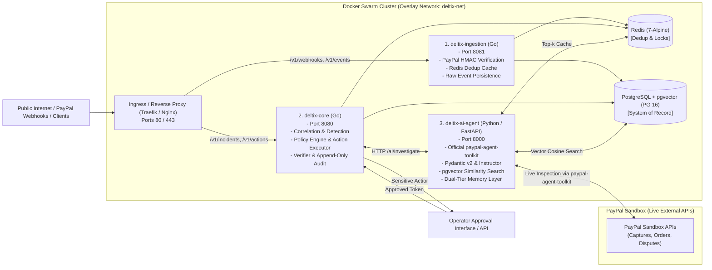
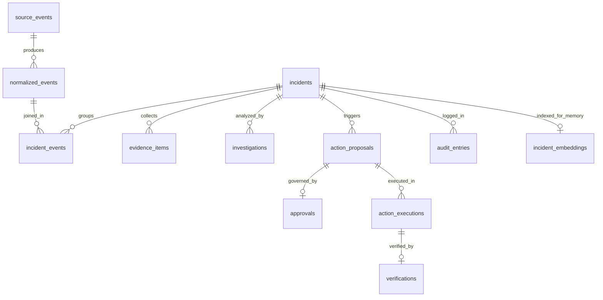
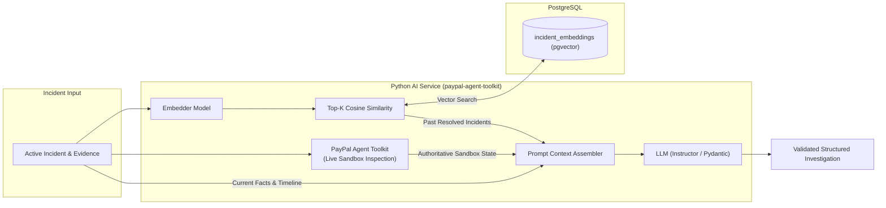
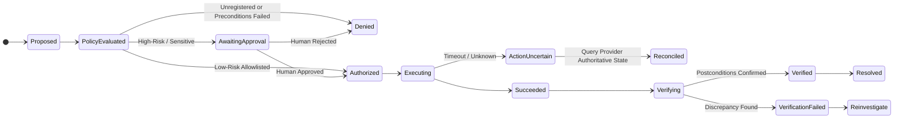

# DELTIX — Project Context

## 1. Product Overview

DELTIX is an intelligent incident investigation and policy-controlled recovery system for distributed payment workflows. It correlates events across payment providers (PayPal Sandbox) and internal merchant services, reconstructs incident timelines, verifies authoritative payment state using the official **PayPal Agent Toolkit**, retrieves historical incident patterns via a vector memory layer, proposes evidence-backed remediation through an AI agent, and executes only deterministic, policy-permitted recovery actions.

- **Architecture:** Streamlined Microservices orchestrated via **Docker Swarm**
- **Core Microservices:**
  1. `deltix-ingestion` (Go) — Webhook receiver, HMAC verification, Redis deduplication
  2. `deltix-core` (Go) — Correlation, deterministic detection rules, policy engine, action executor, independent verifier, audit trail
  3. `deltix-ai-agent` (Python / FastAPI) — Powered by the official `paypal-agent-toolkit`, Pydantic v2 schemas, LLM reasoning, `pgvector` memory layer
- **Primary Database:** PostgreSQL 16 (system-of-record, ACID state machine, `pgvector` extension for historical memory, indexed offsets for high-speed cursor queries)
- **Caching & Locks:** Redis 7 (sub-millisecond deduplication, distributed worker locking, memory top-k cache)
- **Deployment Platform:** Docker Swarm with overlay networking, secret management, and zero-downtime rolling updates (optimized for free/low-resource VPS environments)

---

## 2. Core Non-Negotiable Engineering Principles

1. **Authoritative State Verification:** The payment provider's authoritative state must always be queried and verified via the official PayPal Agent Toolkit before executing any recovery dependent on payment status.
2. **Never Blindly Repeat Money Operations:** Never repeat a money-moving operation simply because an outbound request timed out. Reconcile with the provider first.
3. **LLM as Untrusted Input:** The AI model is strictly an analyst. While it can call read-only tools from the PayPal Agent Toolkit to inspect orders and captures, it cannot authorize, execute money mutations, or dictate policy. All outputs must undergo strict schema validation and deterministic policy checks.
4. **Deterministic Policy & Append-Only Audit:** Every remediation action must pass deterministic Go policy checks and write an immutable audit trail.
5. **Idempotent Ingestion:** Raw events are durably persisted to `source_events` before acknowledgement. Redis and PostgreSQL constraints guarantee zero duplicate execution.
6. **Restart-Safe Recovery:** Workflow and action execution states are persisted transactionally; process restarts must not lose in-flight action state.
7. **Unified Pipeline for Ops & Security:** Operational failures and security incidents share the investigation pipeline but enforce distinct evidence requirements and recovery policies.

---

## 3. Microservices Architecture & Swarm Topology



### End-to-End Processing Steps
1. **Ingest & Verify (`deltix-ingestion`):** Receive webhook/event. Verify PayPal HMAC signature. Fast deduplication check in Redis (`SET key val NX EX 300`). Persist raw event to PostgreSQL `source_events` prior to returning HTTP 200.
2. **Normalize & Deduplicate (`deltix-core`):** Transform raw payload into canonical `NormalizedEvent`. Unique DB constraints ensure zero duplicate records.
3. **Correlate (`deltix-core`):** Group related events using exact identifiers (`payment_id`, `order_id`, `request_id`, `credential_ref`).
4. **Detect (`deltix-core`):** Deterministic detection rules trigger incident creation upon state discrepancies (e.g. `PAYMENT_CAPTURED_ORDER_PENDING`).
5. **AI Investigation with Live Toolkit (`deltix-ai-agent`):** 
   - `deltix-core` requests investigation from `deltix-ai-agent`.
   - The AI agent calls the official **`paypal-agent-toolkit`** (e.g. `get_capture_details`) to fetch authoritative live Sandbox state directly.
   - Queries `pgvector` for top-k similar historical incidents.
   - Assembles verified facts citing evidence IDs and proposes typed remediation actions.
6. **Policy Evaluation (`deltix-core`):** Go policy engine deterministically validates the proposed action against an allowlist and prerequisites (`ALLOW`, `REQUIRE_APPROVAL`, `DENY`).
7. **Action Execution (`deltix-core`):** Safe, low-risk actions run automatically under distributed locks in Redis. High-risk actions wait for human operator approval.
8. **Independent Verification (`deltix-core`):** Re-reads authoritative sources to verify declared postconditions.
9. **Audit (`deltix-core`):** Immutable record appended to `audit_entries`.

---

## 4. Key Incident Scenarios

### Operational Incident: `PAYMENT_CAPTURED_ORDER_PENDING`
- **Condition:** PayPal confirms payment capture (`COMPLETED`), but internal merchant order remains in `PENDING` state beyond the grace period.
- **Investigation:** `deltix-ai-agent` calls `paypal-agent-toolkit.get_capture_details(capture_id)` to verify the live capture in PayPal Sandbox.
- **Remediation Action:** `REPROCESS_INTERNAL_ORDER_EVENT` or `REBUILD_ORDER_PROJECTION` (low-risk, automatic execution once preconditions pass).
- **Verification:** Independent check confirming internal order is updated to `PAID` and provider capture remains `COMPLETED`.

### Security Incident: `PAYOUT_WITHOUT_BUSINESS_AUTHORIZATION`
- **Condition:** Payout request event is detected with no matching approved business instruction, or beneficiary verification is absent.
- **Investigation:** `deltix-ai-agent` inspects authorization records and payout transaction parameters.
- **Remediation Action:** `PAUSE_PAYOUT_ROUTE` or `RESTRICT_CREDENTIAL` (high-risk, strictly requires human approval).
- **Verification:** Confirm route/credential is disabled and subsequent test requests are rejected.

---

## 5. Domain Model & PostgreSQL Schema (with pgvector & Indexed Offsets)



### High-Performance Indexed Offset (Keyset Pagination)
To prevent $O(N)$ sequential scan degradation on streaming tables, DELTIX enforces **Indexed Offset** pagination using composite indices on `(timestamp_col DESC, id DESC)`. Queries jump directly to the index offset:
`WHERE (occurred_at, id) < ($cursor_time, $cursor_id) ORDER BY occurred_at DESC, id DESC LIMIT $limit`.

### Key Tables
- `source_events`: Raw immutable payload, signature verification status, unique `(source, source_event_id)`, composite index on `(created_at DESC, id DESC)`.
- `normalized_events`: Canonical envelope with composite index on `(occurred_at DESC, id DESC)`, exact indices on `payment_id`, `order_id`, `request_id`.
- `incidents`: Problem tickets with severity, status, composite index on `(last_seen_at DESC, id DESC)`.
- `incident_events`: Many-to-many join mapping normalized events to incidents.
- `incident_embeddings`: Embeddings generated by the Python service stored in a `vector(1536)` column with HNSW index for historical similarity search.
- `evidence_items`: Authoritative facts, observations, and provider queries with index on `(incident_id, observed_at DESC, id DESC)`.
- `investigations`: AI investigation records tracking prompt versions, structured JSON findings, and citations.
- `action_proposals`: Typed remediation proposals with explicit preconditions, postconditions, risk tier, and idempotency key.
- `approvals`: Human operator approvals/rejections with reason and actor ID.
- `action_executions`: Durable records of execution attempts with concurrency locks.
- `verifications`: Independent validation of declared postconditions.
- `audit_entries`: Append-only system log with composite index on `(created_at DESC, id DESC)`.

---

## 6. Memory Layer Architecture

The memory layer is documented in detail in [`memory/01-memory-architecture.md`](file:///d:/PayPal/DelTix/deltix_docs/memory/01-memory-architecture.md) and [`memory/02-vector-schema-retrieval.md`](file:///d:/PayPal/DelTix/deltix_docs/memory/02-vector-schema-retrieval.md).



1. **Working Memory (Active Incident):** Bounded chronological timeline, authoritative evidence items from the PayPal Agent Toolkit, and citation enforcement.
2. **Episodic Memory (Historical Resolutions):** Stored in `incident_embeddings` via `pgvector` with HNSW cosine distance indexing and Redis top-k caching.
3. **Deterministic Policy Boundary:** The memory layer and AI agent only propose actions. The Go policy engine deterministically authorizes or denies.

---

## 7. Action Execution & Policy Boundaries



### Action Allowlist
- **Automatic (Low-Risk):**
  - `REPROCESS_INTERNAL_ORDER_EVENT`: Re-applies internal event if PayPal capture is verified and order is pending.
  - `REBUILD_ORDER_PROJECTION`: Re-computes derived merchant state from authoritative records.
- **Human Approval Required (High-Risk):**
  - `PAUSE_PAYOUT_ROUTE`
  - `RESTRICT_CREDENTIAL`
  - Any refund, capture, payout, or production-impacting operation.
- **Denied:**
  - Any unregistered action, missing preconditions, or shell/code execution attempts.

---

## 8. Deployment: Docker Swarm Specification

Comprehensive deployment documentation is available in [`architecture/05-deployment-docker-swarm.md`](file:///d:/PayPal/DelTix/deltix_docs/architecture/05-deployment-docker-swarm.md).

```text
deltix/
├── services/
│   ├── ingestion/             # deltix-ingestion (Go, Dockerfile)
│   ├── core/                  # deltix-core (Go, Dockerfile)
│   └── ai_agent/              # deltix-ai-agent (Python/FastAPI, Dockerfile)
├── deploy/
│   ├── docker-stack.yml       # Production Swarm stack definition
│   └── traefik.yml            # Reverse proxy & routing config
├── configs/                   # Service environment configs
└── deltix_docs/               # Complete engineering documentation
```

### Swarm Deployment Command
```bash
# 1. Initialize Swarm
docker swarm init

# 2. Deploy the stack
docker stack deploy -c deploy/docker-stack.yml deltix

# 3. Check service health
docker stack services deltix
```
