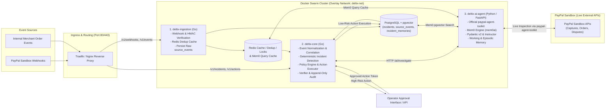

# System Overview

## 1. High-Level Architecture (Microservices in Docker Swarm with PayPal Agent Toolkit & Mem0)

DELTIX is organized as a streamlined microservices system orchestrated via **Docker Swarm**, integrating directly with live PayPal Sandbox APIs using the official **PayPal Agent Toolkit** and managing episodic memory with the open-source **Mem0** engine.

## 2. Microservice Boundaries

1. **`deltix-ingestion` (Go):** Publicly accessible webhook receiver. Dedicated to signature verification, Redis deduplication (`SETNX`), and atomic writes to `source_events`. Isolated so inbound traffic spikes cannot starve core recovery processing.
2. **`deltix-core` (Go):** The primary engine and state machine. Normalizes raw events, correlates by exact business keys, evaluates deterministic detection rules, and manages incident lifecycles. Enforces policy allowlists, executes safe internal actions, verifies postconditions, and maintains the append-only audit log.
3. **`deltix-ai-agent` (Python / FastAPI):** Handles AI investigation. Mounts the official `paypal-agent-toolkit` to perform live read-only inspection against PayPal Sandbox, invokes **Mem0** (`mem0ai`) over PostgreSQL `pgvector` to retrieve verified past incident resolutions, runs LLM reasoning with strict Pydantic schemas, and returns verified facts citing evidence IDs.

## 3. Storage & Infrastructure Layer

- **PostgreSQL + pgvector:** Durable system-of-record. Houses `source_events`, `normalized_events`, `incidents`, `evidence_items`, `audit_entries`, and `incident_memories` (managed by Mem0 with HNSW cosine distance index). Enforces indexed offset pagination for high-speed cursor queries.
- **Redis (7-Alpine):** In-memory sub-millisecond deduplication, distributed worker locking (`Redlock`), and Mem0 query caching (`mem0:query:*`).
- **Docker Swarm:** Overlay network (`deltix-net`), internal DNS resolution, secret distribution (`/run/secrets/*`), resource quotas, and zero-downtime rolling updates.
