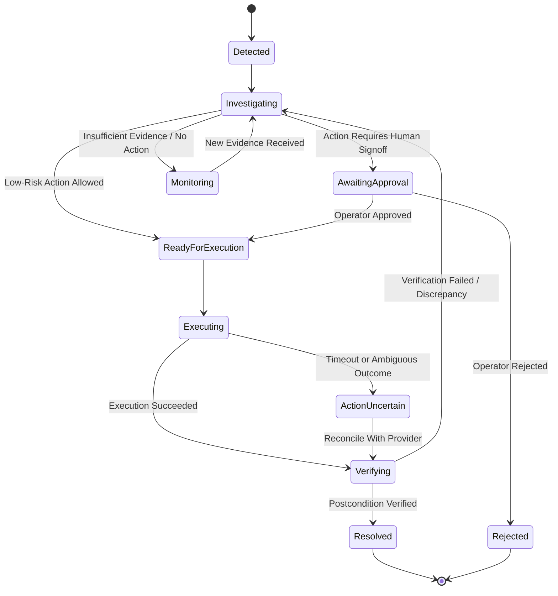
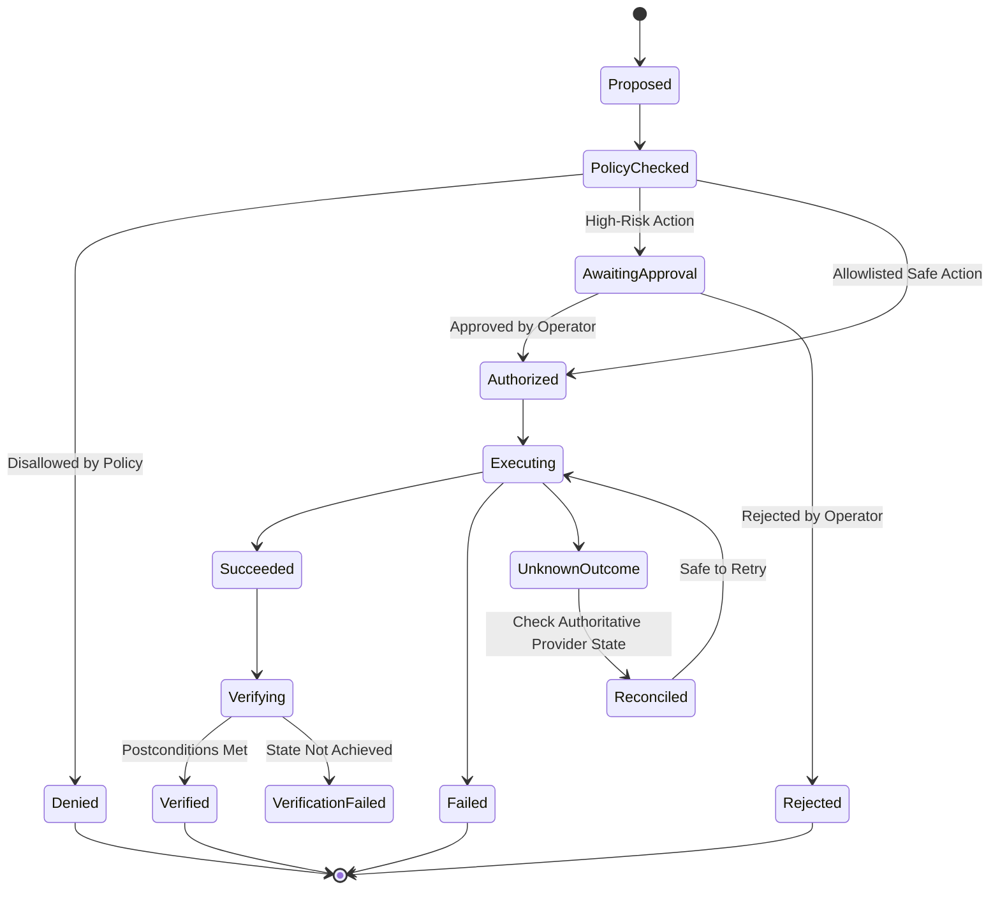

# Domain Model and State Machines

## 1. Core Entities

- **SourceEvent:** Immutable raw event received from an external or internal source.
- **NormalizedEvent:** Canonical representation with indexed correlation identifiers.
- **Incident:** A grouped operational or security problem requiring investigation.
- **EvidenceItem:** A source-backed fact, observation, or authoritative check.
- **IncidentEmbedding:** Vector representation of incident characteristics for similarity search in the memory layer.
- **Investigation:** Structured analysis produced by the AI service citing specific evidence IDs.
- **ActionProposal:** Typed remediation proposal with explicit preconditions and postconditions.
- **Approval:** Human decision record for an action requiring approval.
- **ActionExecution:** Durable record of an attempted action execution.
- **Verification:** Independent proof that an action's postconditions were achieved.
- **AuditEntry:** Append-only record of important decisions, state transitions, and actor actions.

---

## 2. Normalized Event Envelope

```json
{
  "event_id": "source-specific-id",
  "source": "paypal_webhook",
  "event_type": "PAYMENT.CAPTURE.COMPLETED",
  "occurred_at": "2026-11-02T10:00:00Z",
  "received_at": "2026-11-02T10:00:02Z",
  "correlation": {
    "payment_id": "PAY-731",
    "order_id": "ORD-2048",
    "request_id": "req-123",
    "service": "order-service",
    "credential_ref": null
  },
  "payload": {},
  "trust": {
    "signature_verified": true,
    "source_authenticated": true
  }
}
```

*Note: Raw secrets, API keys, and sensitive financial data are never stored in event payloads.*

---

## 3. Incident Lifecycle State Machine



---

## 4. Action Lifecycle State Machine



---

## 5. Evidence Semantics & Memory Layer

Every evidence item must record:
- `kind`: `OBSERVED`, `AUTHORITATIVE_QUERY`, `DERIVED`, `MISSING`, or `CONTRADICTORY`.
- `source_ref`: Event ID, PayPal capture ID, or internal database record ID.
- `observed_at`: Precise timestamp.
- `claim`: Concise factual statement.
- `details`: Structured JSON attributes.

### Fact Classification Rules for AI:
- **Verified Fact:** Directly supported by an authoritative record; must cite `evidence_ids`.
- **Hypothesis:** Plausible interpretation of multiple facts with noted limitations.
- **Unknown:** Crucial data that is unavailable or could not be queried.
- **Contradiction:** Disagreement between authoritative sources requiring reconciliation.
