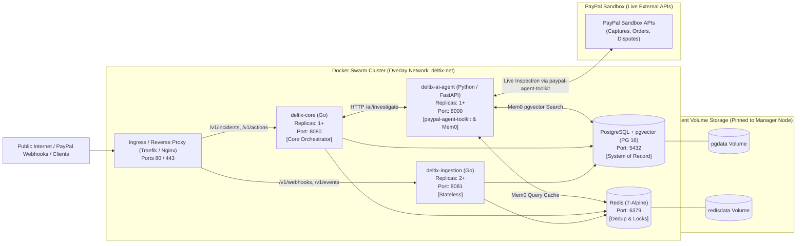

# Deployment Architecture: Docker Swarm

## 1. Overview & Swarm Topology

DELTIX is deployed as a **streamlined microservices stack** orchestrated with **Docker Swarm**. This architecture provides lightweight container clustering, declarative service replicas, zero-downtime rolling updates, native overlay networking, and built-in DNS service discovery without the operational overhead and high RAM consumption of Kubernetes.

Live external PayPal Sandbox queries are handled natively by the Python AI agent using the official `paypal-agent-toolkit`.



---

## 2. Microservices Breakdown & Sizing (Free-Tier Optimized)

Docker Swarm allows hard memory and CPU limits per service, ensuring stability on free-tier VPS instances (e.g., 2–4 vCPU, 4–8 GB RAM).

| Microservice | Language | Replicas | CPU Limit | Memory Limit | Stateful? | Swarm Placement |
| :--- | :--- | :--- | :--- | :--- | :--- | :--- |
| **`ingestion`** | Go | 2 | 0.5 CPU | 256 MB | Stateless | Any worker/manager |
| **`core`** | Go | 1 | 0.75 CPU | 512 MB | Stateless | Any worker/manager |
| **`ai-agent`** | Python | 1 | 1.0 CPU | 1024 MB | Stateless | Any worker/manager |
| **`postgres`** | C / pgvector | 1 | 1.0 CPU | 1024 MB | **Stateful** | Pinned: `node.role == manager` |
| **`redis`** | C / Alpine | 1 | 0.5 CPU | 256 MB | **Stateful** | Pinned: `node.role == manager` |
| **`traefik`** | Go | 1 | 0.25 CPU | 128 MB | Stateless | Pinned: `node.role == manager` |

Total minimum footprint: **~3.2 GB RAM**, easily running on a single free/low-cost VPS or distributed across 2-3 worker nodes.

---

## 3. Production Swarm Stack Specification (`docker-stack.yml`)

```yaml
version: "3.8"

networks:
  deltix-net:
    driver: overlay
    attachable: true

volumes:
  pgdata:
    driver: local
  redisdata:
    driver: local

secrets:
  paypal_client_id:
    external: true
  paypal_client_secret:
    external: true
  paypal_webhook_id:
    external: true
  gemini_api_key:
    external: true
  db_password:
    external: true

services:
  traefik:
    image: traefik:v2.10
    command:
      - "--providers.docker=true"
      - "--providers.docker.swarmmode=true"
      - "--providers.docker.exposedbydefault=false"
      - "--entrypoints.web.address=:80"
      - "--entrypoints.websecure.address=:443"
    ports:
      - "80:80"
      - "443:443"
    volumes:
      - /var/run/docker.sock:/var/run/docker.sock:ro
    networks:
      - deltix-net
    deploy:
      placement:
        constraints: [node.role == manager]
      restart_policy:
        condition: on-failure

  ingestion:
    image: deltix/ingestion:latest
    secrets:
      - paypal_webhook_id
      - db_password
    environment:
      PORT: "8081"
      REDIS_URL: "redis://redis:6379"
      DB_HOST: "postgres"
      DB_PORT: "5432"
      DB_NAME: "deltix"
      DB_USER: "deltix"
      DB_PASSWORD_FILE: "/run/secrets/db_password"
    networks:
      - deltix-net
    deploy:
      replicas: 2
      update_config:
        parallelism: 1
        order: start-first
        failure_action: rollback
      resources:
        limits:
          cpus: "0.50"
          memory: 256M
      labels:
        - "traefik.enable=true"
        - "traefik.http.routers.ingest.rule=PathPrefix(`/v1/webhooks`) || PathPrefix(`/v1/events`)"
        - "traefik.http.routers.ingest.entrypoints=web"
        - "traefik.http.services.ingest.loadbalancer.server.port=8081"

  core:
    image: deltix/core:latest
    secrets:
      - paypal_client_id
      - paypal_client_secret
      - db_password
    environment:
      PORT: "8080"
      AI_SERVICE_URL: "http://ai-agent:8000"
      REDIS_URL: "redis://redis:6379"
      DB_HOST: "postgres"
      DB_PORT: "5432"
      DB_NAME: "deltix"
      DB_USER: "deltix"
      DB_PASSWORD_FILE: "/run/secrets/db_password"
    networks:
      - deltix-net
    deploy:
      replicas: 1
      update_config:
        parallelism: 1
        order: start-first
      resources:
        limits:
          cpus: "0.75"
          memory: 512M
      labels:
        - "traefik.enable=true"
        - "traefik.http.routers.core.rule=PathPrefix(`/v1/incidents`) || PathPrefix(`/v1/actions`)"
        - "traefik.http.routers.core.entrypoints=web"
        - "traefik.http.services.core.loadbalancer.server.port=8080"

  ai-agent:
    image: deltix/ai-agent:latest
    secrets:
      - gemini_api_key
      - paypal_client_id
      - paypal_client_secret
      - db_password
    environment:
      PORT: "8000"
      GEMINI_API_KEY_FILE: "/run/secrets/gemini_api_key"
      PAYPAL_CLIENT_ID_FILE: "/run/secrets/paypal_client_id"
      PAYPAL_CLIENT_SECRET_FILE: "/run/secrets/paypal_client_secret"
      PAYPAL_ENVIRONMENT: "sandbox"
      DATABASE_URL: "postgresql://deltix:@postgres:5432/deltix"
      DB_PASSWORD_FILE: "/run/secrets/db_password"
      REDIS_URL: "redis://redis:6379"
    networks:
      - deltix-net
    deploy:
      replicas: 1
      resources:
        limits:
          cpus: "1.0"
          memory: 1024M

  postgres:
    image: pgvector/pgvector:pg16
    secrets:
      - db_password
    environment:
      POSTGRES_DB: deltix
      POSTGRES_USER: deltix
      POSTGRES_PASSWORD_FILE: /run/secrets/db_password
    volumes:
      - pgdata:/var/lib/postgresql/data
    networks:
      - deltix-net
    deploy:
      placement:
        constraints:
          - node.role == manager
      resources:
        limits:
          cpus: "1.0"
          memory: 1024M

  redis:
    image: redis:7-alpine
    command: ["redis-server", "--appendonly", "yes"]
    volumes:
      - redisdata:/data
    networks:
      - deltix-net
    deploy:
      placement:
        constraints:
          - node.role == manager
      resources:
        limits:
          cpus: "0.5"
          memory: 256M
```

---

## 4. Swarm Deployment Runbook

### Step 1: Initialize Swarm
On the manager server:
```bash
docker swarm init --advertise-addr <SERVER_IP>
```

### Step 2: Create Secrets
```bash
echo "your-paypal-client-id" | docker secret create paypal_client_id -
echo "your-paypal-client-secret" | docker secret create paypal_client_secret -
echo "your-paypal-webhook-id" | docker secret create paypal_webhook_id -
echo "your-gemini-or-openai-key" | docker secret create gemini_api_key -
openssl rand -base64 24 | docker secret create db_password -
```

### Step 3: Deploy the Stack
```bash
docker stack deploy -c docker-stack.yml deltix
```

### Step 4: Verify Services Status
```bash
docker stack services deltix
docker service logs -f deltix_core
```

### Step 5: Rolling Updates & Zero Downtime
To update a service with a new image build:
```bash
docker service update --image deltix/ingestion:v2 --update-order start-first deltix_ingestion
```
Docker Swarm brings up the new container, confirms health, and only then tears down the old container.

### Step 6: Horizontal Scaling
To scale up the webhook ingestion layer during high traffic:
```bash
docker service scale deltix_ingestion=4
```
Swarm automatically load-balances requests across all 4 replicas through the overlay routing mesh.
