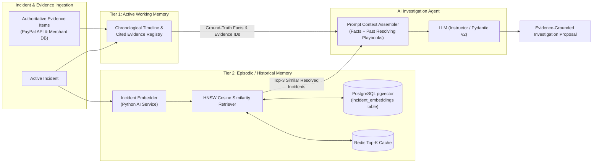

# Memory Layer: Architecture & Design

## 1. Overview & Purpose

In financial and distributed systems like DELTIX, an AI agent cannot rely on unconstrained, conversational chat history or ungrounded memory. Hallucinations or untracked state can cause improper automated recovery actions.

The DELTIX Memory Layer is a **hybrid dual-tier memory system**:
1. **Tier 1: Active Working Memory (Incident-Scoped)** — Authoritative, deterministic timeline and evidence items strictly bounded to the currently investigated incident.
2. **Tier 2: Episodic / Historical Memory (Long-Term)** — Vectorized representations of historically resolved incidents, remediations, and verified postconditions powered by PostgreSQL's `pgvector` extension and Redis caching.

---

## 2. Memory Tier Details

### Tier 1: Active Working Memory
- **Scope:** Single incident lifecycle.
- **Components:**
  - `source_events` & `normalized_events` tied to the incident.
  - `evidence_items` (e.g. authoritative capture query from PayPal Sandbox).
  - Chronological timeline entries.
- **Rule:** The LLM is strictly prohibited from asserting facts that lack an associated `evidence_id` from Working Memory.

### Tier 2: Episodic / Historical Memory
- **Scope:** System-wide historical knowledge base.
- **Storage:** PostgreSQL table `incident_embeddings` with `vector(1536)` embeddings.
- **Indexing:** Hierarchical Navigable Small World (HNSW) index using cosine distance (`vector_cosine_ops`).
- **Retrieval Flow:**
  1. When an incident is flagged (e.g. `PAYMENT_CAPTURED_ORDER_PENDING`), the Python AI service extracts incident features (type, merchant ID, error code, service tags).
  2. Generates an embedding vector.
  3. Queries `pgvector` for the top-$k$ nearest **resolved** incidents where `verification.status = 'VERIFIED'`.
  4. Injects the past resolution actions and rationale as few-shot context into the LLM prompt.

---

## 3. Fast Caching with Redis

To avoid redundant vector embedding queries for repeated or flapping incidents:
- **Cache Key:** `mem:incident:sim:{incident_type}:{error_signature}`
- **TTL:** 1800 seconds (30 minutes).
- **Behavior:** On cache hit, returns the pre-computed top-$k$ past incident references directly to the prompt assembler.
