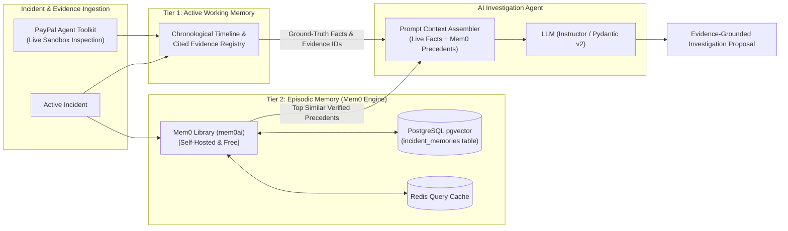

# Memory Layer: Architecture & Design (with Mem0 & pgvector)

## 1. Overview & Purpose

In financial and distributed systems like DELTIX, an AI agent cannot rely on unconstrained, conversational chat history or ungrounded memory. Hallucinations or untracked state can cause improper automated recovery actions.

DELTIX implements a **hybrid dual-tier memory architecture** powered by the open-source **Mem0** engine (`mem0ai`), backed natively by our PostgreSQL (`pgvector`) datastore and Redis cache:

1. **Tier 1: Active Working Memory (Incident-Scoped)** — Authoritative, deterministic timeline and evidence items strictly bounded to the currently investigated incident. Ground truth facts are collected from live PayPal Sandbox APIs via the official `paypal-agent-toolkit`.
2. **Tier 2: Episodic / Historical Memory (Long-Term)** — Managed by **Mem0**, extracting and storing verified historical incident resolutions, root causes, and successful remediation playbooks in PostgreSQL (`pgvector`) with Redis query caching.

---

## 2. Memory Tier Details

### Tier 1: Active Working Memory
- **Scope:** Single incident lifecycle.
- **Components:**
  - `source_events` & `normalized_events` tied to the incident.
  - `evidence_items` retrieved via `paypal-agent-toolkit` (e.g. `get_capture_details`).
  - Chronological timeline entries.
- **Rule:** The LLM is strictly prohibited from asserting facts that lack an associated `evidence_id` from Working Memory.

### Tier 2: Episodic / Historical Memory (Powered by Mem0)
- **Scope:** System-wide historical incident knowledge base.
- **Engine:** Open-source `mem0ai` running self-hosted within the `deltix-ai-agent` Python service.
- **Backend:** PostgreSQL with `pgvector` provider and HNSW cosine distance indexing.
- **Retrieval Flow:**
  1. When an incident is flagged (e.g. `PAYMENT_CAPTURED_ORDER_PENDING`), `deltix-ai-agent` calls `mem0.search()` filtered by `incident_type`.
  2. Mem0 queries `pgvector` for the top-$k$ verified historical incidents.
  3. The past resolution actions, root-cause patterns, and post-action verifications are injected as few-shot precedents into the prompt.

---

## 3. Fast Caching with Redis

Mem0 and DELTIX utilize Redis to prevent redundant embedding generation and vector scans on recurring incidents:
- **Cache Key:** `mem0:query:{incident_type}:{error_signature}`
- **TTL:** 1800 seconds (30 minutes).
- **Behavior:** On cache hit, returns pre-computed precedent playbooks directly to the prompt assembler.
