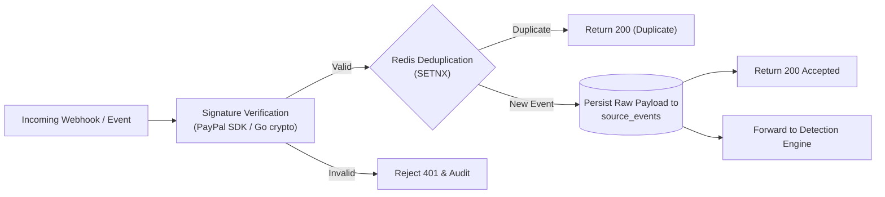

# Service 1: Ingestion & Deduplication Gateway

## 1. Responsibility

The **Ingestion Gateway** acts as the front door for all incoming events from external payment providers (PayPal Sandbox webhooks) and internal merchant services. It handles cryptographic authentication, sub-millisecond deduplication, durable raw persistence, and handoff to the detection engine.



---

## 2. Core Capabilities

1. **PayPal Webhook HMAC Verification:**
   - Validates PayPal transmission headers (`PAYPAL-AUTH-ALGO`, `PAYPAL-TRANSMISSION-ID`, `PAYPAL-CERT-URL`, `PAYPAL-TRANSMISSION-SIG`, `PAYPAL-TRANSMISSION-TIME`).
   - Unauthenticated or forged webhooks are immediately rejected with HTTP 401 and logged as security-relevant audit entries.
   - Payload fields are never trusted prior to signature validation.

2. **Sub-Millisecond Redis Deduplication:**
   - Atomic key check: `SET dedup:{source}:{source_event_id} "1" NX EX 300`.
   - If key exists: returns HTTP 200 immediately to prevent processing duplicate webhook deliveries.
   - If key is new: continues to durable storage.

3. **Durable Raw Persistence:**
   - Raw payload is committed to PostgreSQL `source_events` with `signature_verified = true` before returning an HTTP 200 acknowledgment.
   - Guaranteed zero message loss: if PostgreSQL write fails, HTTP 500 is returned so the provider retries.

4. **Security & Sanitization:**
   - Raw credentials, API secrets, and sensitive authentication headers are stripped before logging.

---

## 3. Go Interface & Data Model

```go
type IngestedEvent struct {
    Source        string          `json:"source"`
    SourceEventID string          `json:"source_event_id"`
    EventType     string          `json:"event_type"`
    OccurredAt    time.Time       `json:"occurred_at"`
    Payload       json.RawMessage `json:"payload"`
    Verified      bool            `json:"verified"`
}

type IngestionGateway interface {
    // IngestWebhook handles external PayPal Sandbox webhook HTTP requests
    IngestWebhook(ctx context.Context, headers http.Header, body []byte) (eventID string, duplicate bool, err error)
    
    // IngestInternalEvent handles merchant order and service events
    IngestInternalEvent(ctx context.Context, event IngestedEvent) (eventID string, duplicate bool, err error)
}
```

---

## 4. Acceptance Criteria
- Valid PayPal Sandbox webhook returns HTTP 200 and inserts into `source_events`.
- Replaying the same webhook returns HTTP 200 (duplicate detected) without re-inserting or re-processing.
- Forged signature returns HTTP 401.
- Database outage returns HTTP 500 without acknowledging receipt.
