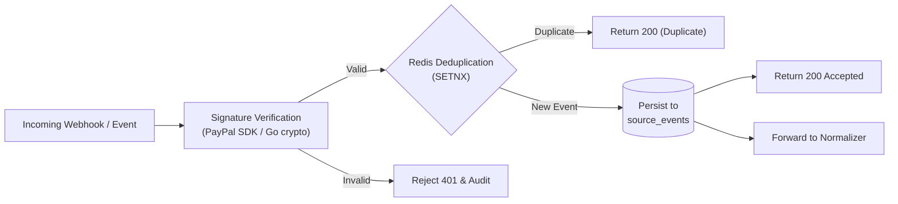

# Service: Event Ingestion

## Responsibility

Receive webhooks from PayPal Sandbox, events from internal services, and synthetic security events; verify authenticity (HMAC signature); perform sub-millisecond deduplication with Redis; durably persist raw payloads to PostgreSQL `source_events`; and trigger normalization.



## Go Ingestion Interface

```go
type IngestedEvent struct {
    Source        string          `json:"source"`
    SourceEventID string          `json:"source_event_id"`
    EventType     string          `json:"event_type"`
    OccurredAt    time.Time       `json:"occurred_at"`
    Payload       json.RawMessage `json:"payload"`
    Verified      bool            `json:"verified"`
}

type IngestionService interface {
    IngestWebhook(ctx context.Context, headers http.Header, body []byte) (eventID string, duplicate bool, err error)
    IngestInternalEvent(ctx context.Context, event IngestedEvent) (eventID string, duplicate bool, err error)
}
```

## Acceptance Rules
1. PayPal webhook signatures must be verified before payload fields are trusted.
2. In-memory deduplication with Redis prevents race conditions on rapid retries.
3. Durable persistence to PostgreSQL `source_events` must succeed prior to returning HTTP 200.
4. Secrets, auth tokens, and full card details are never written to logs or raw payloads.
