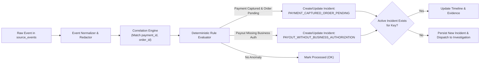
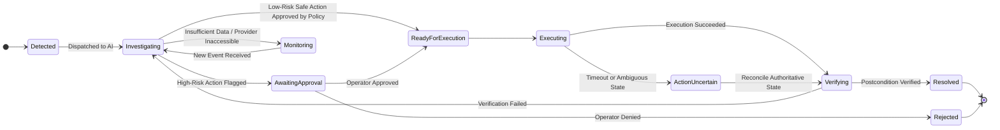

# Service 2: Detection & Incident Engine

## 1. Responsibility

The **Detection & Incident Engine** normalizes raw events into canonical envelopes, correlates them across exact business identifiers, evaluates deterministic rules to spot failures, and manages the incident lifecycle state machine.



---

## 2. Canonical Normalization & Correlation

### Canonical Event Types
- `PAYMENT.ORDER.CREATED`
- `PAYMENT.CAPTURE.COMPLETED`
- `PAYMENT.CAPTURE.DENIED`
- `PAYMENT.REFUND.COMPLETED`
- `ORDER.STATUS.UPDATED`
- `WEBHOOK.DELIVERY.FAILED`
- `PAYOUT.REQUESTED`
- `BUSINESS.APPROVAL.RECORDED`
- `BENEFICIARY.VERIFICATION.COMPLETED`

### Exact-ID Correlation Strategy
Events are correlated using exact business identifiers in hierarchical priority:
1. `payment_id` (PayPal Capture ID / Order ID)
2. `order_id` (Merchant Order ID)
3. `request_id` (Idempotency Key / Trace ID)
4. `credential_ref` (API Key fingerprint)

*Rule:* Events sharing the same primary keys are tied to the same timeline. Time proximity alone is never used to merge distinct transactions.

---

## 3. Initial Deterministic Detection Rules

### Rule 1: Operational (`PAYMENT_CAPTURED_ORDER_PENDING`)
- **Trigger Conditions:**
  1. Authoritative payment provider confirms capture is `COMPLETED`.
  2. Merchant internal order status remains `PENDING` past the configured grace period (e.g., 60 seconds).
  3. `payment_id` and `order_id` match.
- **Severity:** `MEDIUM` (escalates to `HIGH` if elapsed time > 5 minutes).

### Rule 2: Security (`PAYOUT_WITHOUT_BUSINESS_AUTHORIZATION`)
- **Trigger Conditions:**
  1. A `PAYOUT.REQUESTED` event is received.
  2. No matching `BUSINESS.APPROVAL.RECORDED` instruction exists in the system.
  3. Or beneficiary verification is absent.
- **Severity:** `CRITICAL`.

---

## 4. Incident Lifecycle State Machine



---

## 5. Go Detection Interface

```go
type NormalizedEvent struct {
    ID            uuid.UUID       `json:"id"`
    SourceEventID uuid.UUID       `json:"source_event_id"`
    EventType     string          `json:"event_type"`
    PaymentID     *string         `json:"payment_id"`
    OrderID       *string         `json:"order_id"`
    RequestID     *string         `json:"request_id"`
    OccurredAt    time.Time       `json:"occurred_at"`
    Attributes    json.RawMessage `json:"attributes"`
}

type DetectionEngine interface {
    Normalize(ctx context.Context, rawEventID uuid.UUID) (*NormalizedEvent, error)
    Correlate(ctx context.Context, event *NormalizedEvent) (*Incident, error)
    EvaluateRules(ctx context.Context, incident *Incident) ([]Anomaly, error)
}
```
