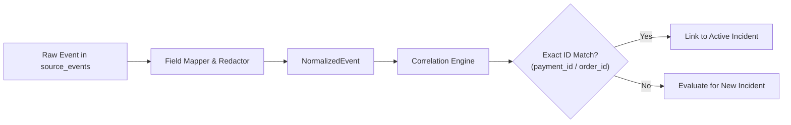

# Service: Normalization and Correlation

## Responsibility

Map source-specific event formats into canonical typed envelopes and group events relating to the same payment, order, or transaction using exact identifiers.

## Canonical Event Types

- `PAYMENT.ORDER.CREATED`
- `PAYMENT.CAPTURE.COMPLETED`
- `PAYMENT.CAPTURE.DENIED`
- `PAYMENT.REFUND.COMPLETED`
- `ORDER.STATUS.UPDATED`
- `WEBHOOK.DELIVERY.FAILED`
- `PAYOUT.REQUESTED`
- `BUSINESS.APPROVAL.RECORDED`
- `BENEFICIARY.VERIFICATION.COMPLETED`
- `AUTH.CREDENTIAL.USED`

## Correlation Strategy

1. **Exact Identifier Matching:** `payment_id` (PayPal Capture/Order ID), `order_id` (Merchant ID), `request_id` (Idempotency key), `credential_ref`.
2. **Deterministic Links:** Events with identical exact keys are tied together.
3. **Time-Window Association:** Used solely as an indicator of proximity; never used alone to merge disparate financial operations.
