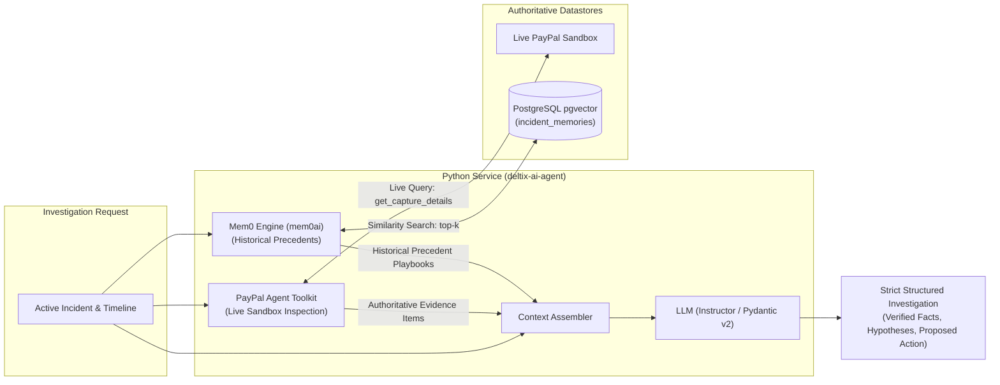

# Service 3: AI Investigation & Dual-Tier Memory

## 1. Responsibility

The **AI Investigation & Memory Service** acts as an expert analyst. It queries live authoritative payment state from PayPal Sandbox using the official `paypal-agent-toolkit`, retrieves similar historical incident playbooks via **Mem0**, and produces structured, evidence-grounded investigations using strictly validated Pydantic schemas.



---

## 2. Live Sandbox Evidence Collection (`paypal-agent-toolkit`)

Instead of mocks or custom HTTP wrappers, the service uses the official PayPal Agent Toolkit:

```python
from paypal_agent_toolkit import PayPalAgentToolkit

toolkit = PayPalAgentToolkit(
    client_id=os.environ["PAYPAL_CLIENT_ID"],
    client_secret=os.environ["PAYPAL_CLIENT_SECRET"],
    environment="sandbox"
)

# Read-only tools mounted for the investigation agent:
# - toolkit.get_capture_details
# - toolkit.get_order_details
# - toolkit.get_transaction_details
# - toolkit.get_dispute_details
```

### Safety Boundary on Mutations
- **Read-only tools (`get_*`):** Executed by the AI agent to gather live ground truth facts.
- **Mutation tools (`refund_*`, `create_payout`):** Strictly restricted. The AI may only **propose** an action, which the Go policy engine validates and executes.

---

## 3. Dual-Tier Memory Layer (Working Memory + Mem0)

1. **Tier 1: Active Working Memory (Incident-Scoped)**
   - Contains the live timeline, normalized events, and authoritative evidence items from the PayPal Sandbox API.
   - Enforces the **Evidence Citation Rule**: The AI is strictly prohibited from claiming a fact without citing an `evidence_id`.

2. **Tier 2: Episodic Memory (Mem0 + pgvector)**
   - Open-source `mem0ai` running self-hosted, pointed to PostgreSQL (`pgvector`) and Redis.
   - When an incident is analyzed, `memory.search()` retrieves the top-3 historically verified resolution playbooks for that incident type.
   - The precedents are injected as few-shot context into the system prompt.

---

## 4. Strict Pydantic v2 Schema Output

```python
from pydantic import BaseModel, Field
from typing import List, Literal, Dict, Any

class VerifiedFact(BaseModel):
    claim: str = Field(description="Factual claim supported by evidence")
    evidence_ids: List[str] = Field(description="Cited evidence IDs")

class Hypothesis(BaseModel):
    claim: str = Field(description="Plausible inference")
    supporting_evidence_ids: List[str]
    limitations: str = Field(description="Remaining unknowns or limits")

class ActionProposal(BaseModel):
    action_type: Literal[
        "REPROCESS_INTERNAL_ORDER_EVENT",
        "REBUILD_ORDER_PROJECTION",
        "PAUSE_PAYOUT_ROUTE",
        "RESTRICT_CREDENTIAL",
        "NO_ACTION"
    ]
    parameters: Dict[str, Any]
    reason: str
    preconditions: List[str]
    postconditions: List[str]

class InvestigationResult(BaseModel):
    summary: str
    verified_facts: List[VerifiedFact]
    hypotheses: List[Hypothesis]
    unknowns: List[str]
    proposed_action: ActionProposal
```

---

## 5. Guardrails
- **Prompt Injection Defense:** External strings from webhooks are treated as raw data, never executable instructions.
- **Fail-Open Detection:** If the LLM or Python service fails, deterministic incident detection remains fully functional.
