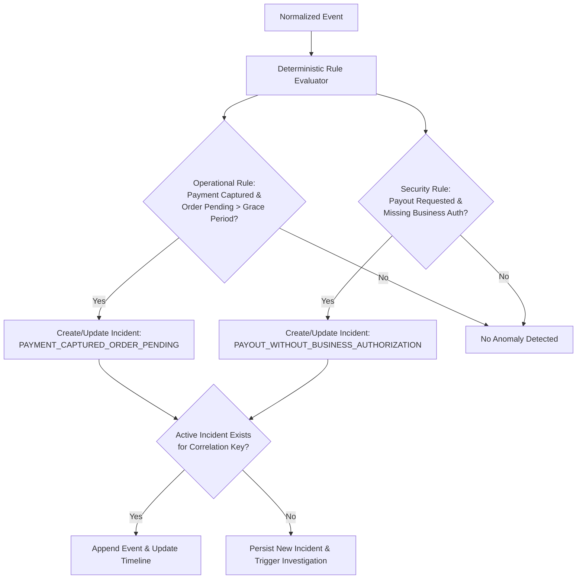

# Service: Detection and Incident Management

## Responsibility

Evaluate deterministic rules against normalized event streams and authoritative state. Create, deduplicate, and transition incidents across their lifecycle.

## Initial Deterministic Rules

### 1. Operational: `PAYMENT_CAPTURED_ORDER_PENDING`
- **Trigger:** PayPal capture confirmed `COMPLETED`, but internal order state remains `PENDING` past configured grace period (e.g., 60 seconds).
- **Severity:** `MEDIUM` / `HIGH` depending on transaction age.

### 2. Security: `PAYOUT_WITHOUT_BUSINESS_AUTHORIZATION`
- **Trigger:** Simulated payout event received without corresponding approved business instruction or verified beneficiary.
- **Severity:** `CRITICAL`.
