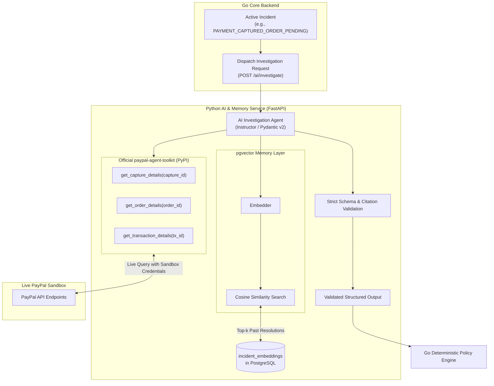

# Service: Evidence and AI Investigation (with PayPal Agent Toolkit & Memory)

## Responsibility

Collect authoritative evidence directly from live PayPal Sandbox APIs using the official **`paypal-agent-toolkit`**, retrieve similar historical incidents via a vector memory layer (`pgvector`), and generate structured, evidence-grounded incident investigations using an AI agent.



---

## 1. Live Authoritative Inspection (PayPal Agent Toolkit)

Rather than writing custom raw HTTP clients or relying on synthetic mocks, the Python AI service imports the official package:

```bash
pip install paypal-agent-toolkit instructor pydantic
```

The agent initializes the toolkit using the environment's PayPal Sandbox credentials:

```python
from paypal_agent_toolkit import PayPalAgentToolkit

toolkit = PayPalAgentToolkit(
    client_id=os.environ["PAYPAL_CLIENT_ID"],
    client_secret=os.environ["PAYPAL_CLIENT_SECRET"],
    environment="sandbox"
)

# Read-only inspection tools made available to the agent:
read_tools = [
    toolkit.get_capture_details,
    toolkit.get_order_details,
    toolkit.get_transaction_details,
    toolkit.get_dispute_details
]
```

### Safety Boundary on Mutations
The toolkit also includes write operations (`refund_capture`, `create_payout`). 
* **Read-only tools** are executed by the agent to collect live evidence.
* **Mutation tools** are NOT executed autonomously by the AI. The AI may only **propose** a typed action, which the Go policy engine must approve and execute.

---

## 2. Memory Layer: Historical Retrieval (Python & pgvector)

The Python service utilizes `pgvector` in PostgreSQL to store embeddings of resolved incidents and their verified remediations. Detailed architecture is in [`memory/01-memory-architecture.md`](file:///d:/PayPal/DelTix/deltix_docs/memory/01-memory-architecture.md).
- **Embedding Generation:** Incident features (type, severity, error pattern, failed services) are vectorized.
- **Retrieval:** Cosine distance query finds the top-3 historically similar resolved incidents.
- **Prompt Injection:** Past successful resolution playbooks are supplied as few-shot memory to guide the model.

---

## 3. Strict AI Output Schema (Pydantic v2)

The AI agent is constrained to return structured data validated with `instructor`:

```python
from pydantic import BaseModel, Field
from typing import List, Literal, Dict, Any

class VerifiedFact(BaseModel):
    claim: str = Field(description="Factual statement directly supported by live PayPal or DB evidence")
    evidence_ids: List[str] = Field(description="List of cited evidence IDs supporting the claim")

class Hypothesis(BaseModel):
    claim: str = Field(description="Plausible explanation based on evidence")
    supporting_evidence_ids: List[str]
    limitations: str = Field(description="What remains unproven")

class ActionProposal(BaseModel):
    action_type: Literal[
        "REPROCESS_INTERNAL_ORDER_EVENT",
        "REBUILD_ORDER_PROJECTION",
        "PAUSE_PAYOUT_ROUTE",
        "RESTRICT_CREDENTIAL",
        "NO_ACTION"
    ]
    parameters: Dict[str, Any]
    reason: str
    preconditions: List[str]
    postconditions: List[str]

class InvestigationResult(BaseModel):
    summary: str
    verified_facts: List[VerifiedFact]
    hypotheses: List[Hypothesis]
    unknowns: List[str]
    proposed_action: ActionProposal
```

---

## 4. Guardrails

- Every factual claim must cite valid `evidence_ids`.
- The AI has read-only access via the PayPal Agent Toolkit during investigation.
- If the AI service or PayPal Sandbox API is unavailable, deterministic detection remains unaffected and marks provider status as `UNKNOWN`.
