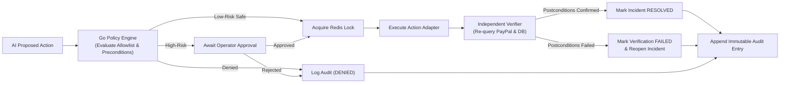

# Service 4: Policy Enforcement, Recovery & Audit

## 1. Responsibility

The **Policy, Recovery & Audit Service** acts as the deterministic governance and execution boundary of DELTIX. It evaluates proposed actions against code-level allowlists, manages approval workflows, executes safe actions with distributed locking in Redis, independently verifies that postconditions were achieved, and maintains an append-only audit trail.



---

## 2. Deterministic Policy Allowlist & Risk Tiers

The Go policy engine is the **sole authority** that grants execution rights. The LLM can only suggest.

### Low-Risk Allowlist (Autonomous Execution)
- `REPROCESS_INTERNAL_ORDER_EVENT`
  - **Preconditions:** PayPal capture verified `COMPLETED`; order status is currently `PENDING`.
  - **Action:** Replays the order processing pipeline.
  - **Expected Postcondition:** Order status updated to `PAID`.
- `REBUILD_ORDER_PROJECTION`
  - **Preconditions:** Authoritative database records available.
  - **Action:** Re-computes derived merchant projections without moving money.

### High-Risk Actions (Strictly Requires Human Approval)
- `PAUSE_PAYOUT_ROUTE`: Suspends simulated or external payout endpoints during suspected unauthorized activity.
- `RESTRICT_CREDENTIAL`: Revokes or restricts an API key under security investigation.
- Any live money movement, capture trigger, or refund.

### Denied Actions
- Any unregistered action type.
- Any action whose preconditions are not 100% satisfied.
- Any proposal attempting arbitrary code or shell execution.

---

## 3. Independent Postcondition Verification

A successful executor response is necessary, but **not sufficient**, to resolve an incident.

The Verifier performs an out-of-band query against the authoritative source:
1. **Order Recovery:** Verifies that internal order status is `PAID` AND re-verifies that PayPal capture status remains `COMPLETED`.
2. **Containment:** Verifies that the route/credential is disabled and subsequent test transactions are rejected.

If the postcondition is not confirmed, the incident is **never** resolved.

---

## 4. Immutable Audit Trail (with Indexed Offsets)

Every decision and state transition creates an append-only `audit_entries` record:
- Event received / deduplicated.
- Incident created / updated.
- Evidence collected.
- AI investigation generated.
- Policy evaluated (`ALLOW`, `REQUIRE_APPROVAL`, `DENY`).
- Operator approval or rejection (with user ID).
- Action execution attempt and result.
- Postcondition verification result.

All audit querying and streaming use indexed offset pagination on `(created_at DESC, id DESC)` for fast $O(1)$ cursor retrieval.

---

## 5. Go Policy & Recovery Interface

```go
type PolicyDecision string

const (
    DecisionAllow           PolicyDecision = "ALLOW"
    DecisionRequireApproval PolicyDecision = "REQUIRE_APPROVAL"
    DecisionDeny            PolicyDecision = "DENY"
)

type PolicyEngine interface {
    Evaluate(ctx context.Context, proposal ActionProposal, authoritativeFacts Facts) (PolicyDecision, error)
}

type ActionExecutor interface {
    Execute(ctx context.Context, proposal ActionProposal, idempotencyKey string) (ExecutionResult, error)
}

type Verifier interface {
    Verify(ctx context.Context, executionID uuid.UUID, expectedPostconditions []string) (bool, error)
}
```
