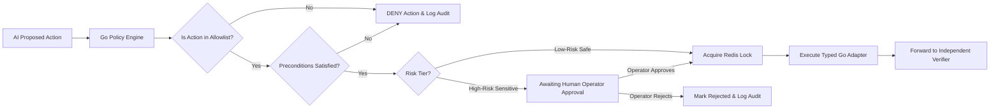

# Service: Policy and Action Execution

## Responsibility

Deterministically evaluate proposed actions in Go, enforce risk tiers, manage approval flows, and execute typed allowlisted recovery actions with distributed locking in Redis.



---

## Action Allowlist & Risk Tiers

### Low-Risk (Automatic Execution)
- `REPROCESS_INTERNAL_ORDER_EVENT`
  - Preconditions: PayPal capture status confirmed `COMPLETED`; order status is `PENDING`.
  - Operation: Idempotently replay order processing event.
- `REBUILD_ORDER_PROJECTION`
  - Preconditions: Authoritative source records available.
  - Operation: Re-derive projection without triggering external money movements.

### High-Risk (Requires Human Approval)
- `PAUSE_SIMULATED_PAYOUT_ROUTE`: Suspends simulated route during suspected unauthorized payout incidents.
- `RESTRICT_SIMULATED_CREDENTIAL`: Restricts simulated API credential under investigation.
- Any live money movement, refund, or live credential alteration.

---

## Go Policy Interface

```go
type PolicyDecision string

const (
    DecisionAllow          PolicyDecision = "ALLOW"
    DecisionRequireApproval PolicyDecision = "REQUIRE_APPROVAL"
    DecisionDeny           PolicyDecision = "DENY"
)

type PolicyEngine interface {
    Evaluate(ctx context.Context, proposal ActionProposal, authoritativeFacts Facts) (PolicyDecision, error)
}

type ActionExecutor interface {
    Execute(ctx context.Context, proposal ActionProposal, idempotencyKey string) (ExecutionResult, error)
}
```
