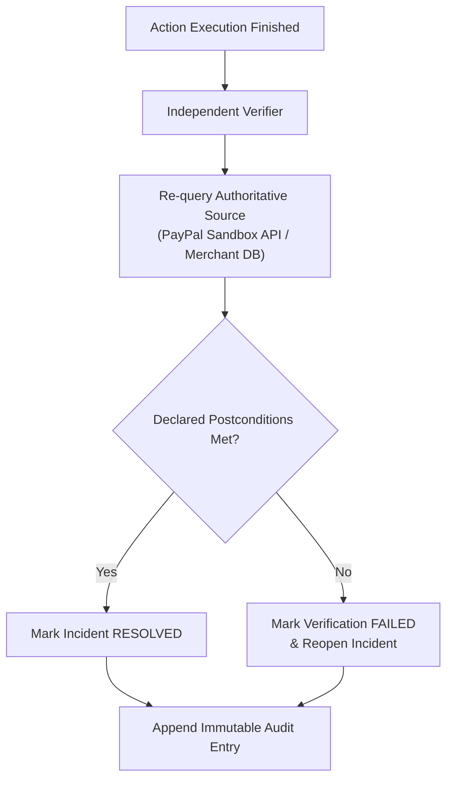

# Service: Verification and Audit

## Responsibility

Independently verify post-action state against authoritative sources and maintain an immutable append-only audit trail of all ingestion events, detections, investigations, policy decisions, approvals, and executions.

---

## 1. Independent Verification

An executor returning success is necessary, but **not sufficient**, to resolve an incident. 

The Verifier performs an out-of-band query against the authoritative source:
- **Order Recovery:** Verifies that internal merchant order status is `PAID` AND PayPal capture status remains `COMPLETED`.
- **Simulated Containment:** Verifies that the simulated payout route is deactivated and subsequent test requests fail.

If postconditions are not confirmed, the incident is never resolved.

---

## 2. Immutable Audit Logging with Indexed Offsets

Every significant state change creates an immutable `audit_entries` record:
- Event received / deduplicated.
- Incident created / updated.
- Evidence gathered.
- AI investigation generated.
- Policy evaluated (`ALLOW`, `REQUIRE_APPROVAL`, `DENY`).
- Operator approval or rejection (with user ID).
- Action execution attempt and result.
- Postcondition verification result.

All audit querying and streaming use indexed offset pagination on `(created_at DESC, id DESC)`. No regular application interface allows update or deletion of audit logs.
