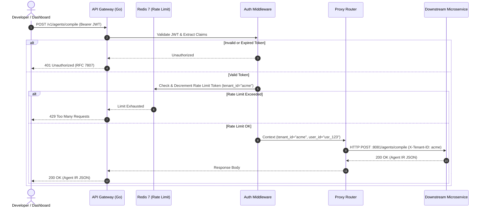

# Service 1 — API Gateway (`01-api-gateway.md`)

## 1. Service Overview

The **API Gateway** is the single entry point for all external client traffic entering the **DelTix** platform. Written in **Go 1.23**, it exposes unified REST and Server-Sent Events (SSE) interfaces to developers and web dashboards, authenticates incoming requests, injects tenant context, enforces Redis-backed rate limiting, normalizes errors, and routes traffic to downstream internal microservices.

---

## 2. Responsibility and Ownership

* **Client Request Termination:** Terminating TLS, validating HTTP methods, headers, and request bodies.
* **Authentication & Authorization:** Verifying JWT tokens, extracting `tenant_id` and `user_id`, and attaching context to request headers.
* **Traffic Routing:** Forwarding requests to internal services based on endpoint paths:
  * `/v1/agents/*` -> Agent Compiler Service (`:8081`)
  * `/v1/runs/*` -> Agent Runtime Service (`:8082`)
  * `/v1/approvals/*` -> Capability & Policy Service (`:8084`)
  * `/v1/memory/*` -> Memory Service (`:8083`)
* **Real-time Event Streaming:** Maintaining persistent Server-Sent Events (SSE) connections to stream live node-by-node agent execution logs to client dashboards.
* **Redis-Backed Rate Limiting:** Enforcing per-tenant request limits using Redis token-bucket counters to prevent denial-of-service and abuse.
* **Unified Error Normalization:** Converting internal service errors into standardized RFC 7807 Problem Details.

---

## 3. Explicit Non-Responsibilities

* **No Compilation Logic:** The API Gateway does not parse natural language, validate Agent IR schemas, or generate test cases.
* **No Agent Execution Logic:** The Gateway does not execute LangGraph workflows or manage graph state.
* **No Database Ownership:** The Gateway has no direct relational database access and does not persist business entities.
* **No Direct PayPal Calls:** The Gateway never contacts PayPal Sandbox directly.

---

## 4. Internal Architecture

The API Gateway is built in **Go 1.23** using high-performance standard library HTTP primitives and lightweight middleware:

```text
[ Client HTTP / SSE ]
         │
         ▼
[ Ingress Port 8080 ]
         │
         ▼
[ Request Context & Tracing Middleware ]
         │
         ▼
[ JWT Authentication & Tenant Context Middleware ]
         │
         ▼
[ Redis-Backed Token Bucket Rate Limiting Middleware ]
         │
         ▼
[ Path Router & Reverse Proxy Engine ]
   ├── /v1/agents/*     ──► Proxy to Compiler Service (:8081)
   ├── /v1/runs/*       ──► Proxy to Runtime Service (:8082)
   ├── /v1/approvals/*  ──► Proxy to Capability & Policy Service (:8084)
   └── /v1/memory/*     ──► Proxy to Memory Service (:8083)
```

---

## 5. Main Components

1. **Auth Middleware (`middleware/auth.go`):** Validates HMAC-SHA256 JWT tokens, validates claims expiration, and sets `X-Tenant-ID` and `X-User-ID` internal headers.
2. **Redis Rate Limiter (`middleware/ratelimit.go`):** Token bucket rate limiter tracking requests per minute per `tenant_id` backed by Redis (`ratelimit:{tenant_id}`).
3. **Proxy Director (`proxy/director.go`):** Custom reverse proxy director injecting internal trace headers (`X-Trace-ID`) and forwarding downstream.
4. **SSE Stream Hub (`sse/hub.go`):** Subscribes to internal execution events from the Runtime Service and fans them out to connected client streams.
5. **Error Handler (`errors/handler.go`):** Intercepts downstream 4xx/5xx responses and formats them into standard JSON problem responses.

---

## 6. Request and Response Contracts

### Example Client Request: Trigger Agent Run
```http
POST /v1/runs HTTP/1.1
Host: api.deltix.dev
Authorization: Bearer eyJhbGciOi...
Content-Type: application/json

{
  "agent_id": "agent_paypal_reconciliation_v1",
  "inputs": {
    "start_date": "2026-11-01T00:00:00Z",
    "end_date": "2026-11-05T23:59:59Z",
    "merchant_id": "MERCHANT-8877"
  }
}
```

### Standard Normalized Error Response (RFC 7807)
```json
{
  "type": "https://deltix.dev/errors/policy-violation",
  "title": "Policy Violation",
  "status": 403,
  "detail": "Requested operation exceeds merchant maximum spend limit of $100.00 USD.",
  "instance": "/v1/runs/run_01j7ax9k/resume",
  "trace_id": "trace_9988aabb1122"
}
```

---

## 7. Database & Cache Ownership

* **Redis Keys Owned:** `ratelimit:{tenant_id}:tokens`, `ratelimit:{tenant_id}:ts`.
* **Relational Database:** None. The API Gateway is completely stateless regarding Supabase.

---

## 8. API Endpoints

| Method | Endpoint | Upstream Target | Description |
| :--- | :--- | :--- | :--- |
| `POST` | `/v1/agents/compile` | `compiler_service:8081` | Submit natural-language prompt for agent compilation. |
| `POST` | `/v1/agents/clarify` | `compiler_service:8081` | Submit answers to clarification questions. |
| `GET` | `/v1/agents/{agent_id}` | `compiler_service:8081` | Retrieve compiled Agent IR and validation status. |
| `POST` | `/v1/runs` | `runtime_service:8082` | Trigger execution of an approved agent. |
| `GET` | `/v1/runs/{run_id}` | `runtime_service:8082` | Get current execution status, step history, and output. |
| `GET` | `/v1/runs/{run_id}/stream` | `runtime_service:8082` | Connect to live Server-Sent Events (SSE) trace stream. |
| `POST` | `/v1/approvals/{approval_id}/decision`| `capability_service:8084`| Submit human approval decision (APPROVE/REJECT). |
| `GET` | `/v1/memory/{agent_id}` | `memory_service:8083` | Inspect long-term semantic memories for an agent. |

---

## 9. Error Handling

* **Upstream Timeout:** If a downstream service fails to respond within 30 seconds, Gateway returns HTTP 504 Gateway Timeout.
* **Upstream Unreachable:** If an internal container is offline, Gateway returns HTTP 503 Service Unavailable with a `Retry-After: 5` header.
* **Rate Limit Exceeded:** If Redis indicates token exhaustion, Gateway returns HTTP 429 Too Many Requests with standard `X-RateLimit-*` headers.

---

## 10. Security Considerations

* **TLS Termination:** Only HTTPS (TLS 1.3) accepted in staging and production.
* **Header Scrubbing:** External headers like `X-Tenant-ID` or `X-Internal-Role` are stripped at ingress to prevent tenant spoofing.
* **CORS Policy:** Strict allowlist restricted to authorized dashboard origins.
* **JWT Validation:** Signature verified with RSA-256 public key; clock skew tolerance capped at 30 seconds.

---

## 11. Dependencies

* **Internal Services:** Compiler Service, Runtime Service, Capability & Policy Service, Memory Service.
* **Infrastructure:** Redis 7 (rate limiting).
* **External Clients:** Web Dashboard, Developer CLI, API integrations.

---

## 12. Mermaid Sequence Diagram



---

## 13. Implementation Milestones

1. **Milestone 1:** Basic Go HTTP server setup with Chi router and mock upstream route registration.
2. **Milestone 2:** JWT authentication middleware and tenant context propagation.
3. **Milestone 3:** Redis-backed token bucket rate limiter middleware.
4. **Milestone 4:** Reverse proxy directors with upstream health checks and timeout policies.
5. **Milestone 5:** SSE stream proxy for live agent execution feeds and RFC 7807 error standardization.

---

## 14. Testing Requirements

* **Unit Tests:** JWT claim decoding, token expiration, Redis rate limiter bucket refill algorithms.
* **Integration Tests:** Reverse proxying with mock upstream HTTP servers, verifying header injection.
* **Security Tests:** Header spoofing rejection tests, malformed JWT rejection tests.
* **Benchmark Tests:** Verifying gateway latency adds < 2ms p99 overhead.
