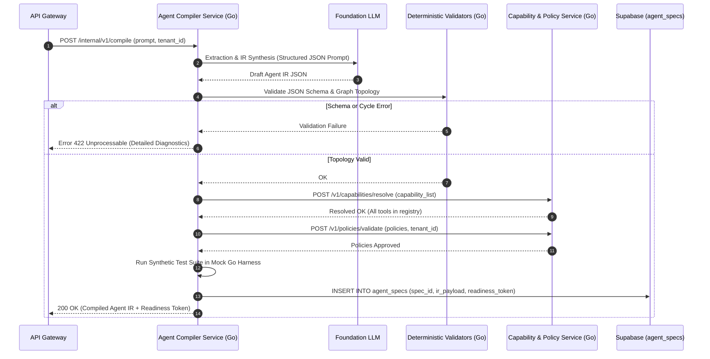

# Service 2 — Agent Compiler Service (`02-agent-compiler-service.md`)

## 1. Service Overview

The **Agent Compiler Service** is the cognitive transformation engine of **DelTix**. Written in **Go 1.23**, it converts ambiguous, high-level natural-language descriptions into validated, strongly typed, policy-governed, executable **Agent Intermediate Representation (Agent IR)** documents. It acts as a multi-stage compiler that blends constrained LLM extraction with deterministic static Go verification, persisting versioned specs to **Supabase**.

---

## 2. Responsibility and Ownership

* **Natural Language Parsing & Intent Extraction:** Extracting agent goals, required inputs, outputs, and business constraints from prompt text.
* **Clarification Dialog Management:** Identifying missing or underspecified constraints (e.g., missing max refund caps or undefined approval rules) and prompting the user for clarification.
* **Agent IR Specification Ownership:** Authoritative owner of the `Agent IR v1.0` JSON Schema and serialization contracts.
* **Static Schema & Graph Topology Validation:** Verifying JSON Schema compliance in Go and analyzing graph topology (detecting disconnected nodes, cycles lacking termination conditions, and invalid transitions).
* **Capability Resolution Client:** Interfacing with the Capability & Policy Service to map requested operations to registered tools.
* **Synthetic Test Generation & Execution:** Generating positive, negative, and permission-breach test scenarios and verifying them in a mock Go harness before agent publication.
* **Spec Persistence:** Storing validated specifications in Supabase (`agent_specs`).

---

## 3. Explicit Non-Responsibilities

* **No Production Agent Execution:** The Compiler Service does **not** execute agents in the live sandbox or manage LangGraph runtime states.
* **No Direct PayPal API Calls:** The Compiler never communicates with PayPal; capability definitions are retrieved from Service 5.
* **No LLM Policy Bypassing:** The Compiler cannot override or bypass policy restrictions enforced by Service 5.

---

## 4. Internal Architecture

The Compiler Service is built in **Go 1.23**, coordinating with foundation LLM APIs via structured JSON Schema output modes, followed by deterministic Go validators:

```text
[ Natural Language Prompt / Clarification Answers ]
                        │
                        ▼
┌────────────────────────────────────────────────────────┐
│  Stage 1: Intent & Entity Extraction (LLM Structured)   │
└───────────────────────┬────────────────────────────────┘
                        │
                        ▼
           [ Missing Constraints? ] ──Yes──► [ Emit Clarification Questions ]
                        │ No
                        ▼
┌────────────────────────────────────────────────────────┐
│  Stage 2: Agent IR Synthesis (LLM Structured Mode)     │
└───────────────────────┬────────────────────────────────┘
                        │
                        ▼
┌────────────────────────────────────────────────────────┐
│  Stage 3: Deterministic Schema Validator (Go)          │
│  - JSON Schema verification against agent_ir_v1.json   │
└───────────────────────┬────────────────────────────────┘
                        │
                        ▼
┌────────────────────────────────────────────────────────┐
│  Stage 4: Graph Topology Analyzer (Go)                 │
│  - Cycle detection, reachability, terminal node check  │
└───────────────────────┬────────────────────────────────┘
                        │
                        ▼
┌────────────────────────────────────────────────────────┐
│  Stage 5: Capability Resolver (HTTP to Service 5)      │
│  - Binds tool IDs, rejects unregistered tools          │
└───────────────────────┬────────────────────────────────┘
                        │
                        ▼
┌────────────────────────────────────────────────────────┐
│  Stage 6: Policy Validator (HTTP to Service 5)         │
│  - Verifies read_only and spending cap compliance      │
└───────────────────────┬────────────────────────────────┘
                        │
                        ▼
┌────────────────────────────────────────────────────────┐
│  Stage 7: Synthetic Test Generator (LLM + Archetypes)  │
└───────────────────────┬────────────────────────────────┘
                        │
                        ▼
┌────────────────────────────────────────────────────────┐
│  Stage 8: Pre-flight Mock Harness Validator (Go)       │
└───────────────────────┬────────────────────────────────┘
                        │
                        ▼
┌────────────────────────────────────────────────────────┐
│  Persist to Supabase agent_specs (Ready for Run)       │
└────────────────────────────────────────────────────────┘
```

---

## 5. Main Components

1. **Prompt Engineer (`compiler/prompts.go`):** Structured system prompts enforcing JSON-only output from the LLM using strict schemas.
2. **IR Schema Validator (`compiler/schema_validator.go`):** Embeds `agent_ir_v1.json` and evaluates candidate IR documents using `gojsonschema`.
3. **Graph Topology Analyzer (`compiler/graph_analyzer.go`):** Implements Tarjan's strongly connected components algorithm and depth-first search (DFS) to detect unreachable nodes and unbounded cycles in Go.
4. **Capability Resolver Client (`compiler/capability_client.go`):** Dispatches verification requests to Service 5 to ensure every capability reference is legitimate.
5. **Synthetic Test Generator (`compiler/test_generator.go`):** Synthesizes test input fixtures and expected assertion outputs.
6. **Mock Test Harness (`compiler/mock_harness.go`):** Runs the graph through a simulated interpreter to verify that transitions and edge conditions fire accurately.
7. **Supabase Repository (`repository/spec_repo.go`):** PostgreSQL repository driver persisting specs and test logs.

---

## 6. Request and Response Contracts

### Compilation Request Contract
```json
{
  "tenant_id": "tenant_acme_corp",
  "prompt": "Build an agent that checks PayPal Sandbox transactions from last week, compares them with orders, and generates a report if there are discrepancies. Never issue refunds.",
  "clarification_answers": {
    "merchant_id": "M_12345678"
  }
}
```

### Clarification Response (If Info Missing)
```json
{
  "status": "NEEDS_CLARIFICATION",
  "questions": [
    {
      "id": "q_read_only",
      "question": "Should this agent be strictly read-only, or should it be allowed to open customer dispute inquiries?",
      "options": ["Strictly Read-Only (Recommended)", "Allow Opening Disputes"]
    }
  ]
}
```

### Successful Compilation Response
```json
{
  "status": "COMPILED",
  "agent_id": "agent_paypal_reconciliation_v1",
  "spec_version": "1.0.0",
  "agent_ir": { "...full Agent IR JSON..." },
  "validation_report": {
    "schema_valid": true,
    "topology_valid": true,
    "capabilities_resolved": ["paypal.transactions.list", "paypal.orders.get"],
    "policy_compliant": true,
    "tests_run": 3,
    "tests_passed": 3,
    "readiness_token": "rtok_77a988bb11ccee"
  }
}
```

---

## 7. Database Ownership

* **Supabase Tables Owned:**
  * `agent_specs`: Stores versioned, validated Agent IR definitions.
    * Columns: `spec_id` (PK), `agent_id`, `version`, `tenant_id`, `ir_payload` (JSONB), `status`, `readiness_token`, `created_at`.
  * `agent_compilation_logs`: Debug traces of LLM prompts and intermediate validation steps.

---

## 8. API Endpoints

| Method | Endpoint | Description |
| :--- | :--- | :--- |
| `POST` | `/internal/v1/compile` | Initiates prompt compilation or processes clarification answers. |
| `GET` | `/internal/v1/specs/{spec_id}` | Retrieves a compiled Agent IR document by ID from Supabase. |
| `GET` | `/internal/v1/specs/{spec_id}/tests` | Retrieves synthetic test suites and execution reports. |
| `POST` | `/internal/v1/specs/{spec_id}/validate` | Triggers a re-validation pass against updated policies. |

---

## 9. Error Handling

* **LLM Schema Hallucination:** If the LLM generates JSON violating the schema, the compiler executes an automated repair prompt up to 2 times before returning a structured compilation error.
* **Unregistered Capabilities:** If the agent requests a tool not in Service 5's registry, compilation fails immediately with `UNREGISTERED_CAPABILITY_ERROR` and lists valid alternatives.
* **Graph Topology Errors:** Detected cycles without bounded iterations emit `UNBOUNDED_GRAPH_CYCLE_ERROR`.

---

## 10. Security Considerations

* **Prompt Injection Resilience:** User requirements are injected into the LLM as user-role data, never as system-role instructions.
* **Deterministic Guardrails:** The LLM's output is treated as untrusted draft input until Go schema and policy validators approve it.
* **Readiness Signature:** When all tests pass, the service generates an HMAC-SHA256 `readiness_token` signed with an internal secret. Service 3 (Runtime) refuses to execute any agent without a valid token.

---

## 11. Dependencies

* **Internal Services:** Capability & Policy Service (Service 5).
* **Storage:** Supabase (PostgreSQL 16 `agent_specs` table).
* **External Providers:** Foundation LLM API (OpenAI/Anthropic/Gemini) configured for structured outputs.

---

## 12. Mermaid Sequence Diagram



---

## 13. Implementation Milestones

1. **Milestone 1:** Definitive `agent_ir_v1.json` JSON schema and Go validator implementation.
2. **Milestone 2:** Graph topology validator (Tarjan's DFS for cycles and reachability in Go).
3. **Milestone 3:** LLM prompt pipeline for extraction and Agent IR synthesis with structured outputs.
4. **Milestone 4:** Capability and Policy client integrations with Service 5.
5. **Milestone 5:** Synthetic test generator and mock sandbox execution harness.
6. **Milestone 6:** Supabase spec persistence repository integration.

---

## 14. Testing Requirements

* **Unit Tests:** JSON Schema validation unit tests (50+ positive/negative test fixtures), graph cycle detection tests.
* **Contract Tests:** Verifying API compatibility with Capability & Policy Service contracts.
* **End-to-End Compiler Tests:** Compiling the three reference agents (Reconciliation, Checkout, Refund Review) and verifying output validity.
