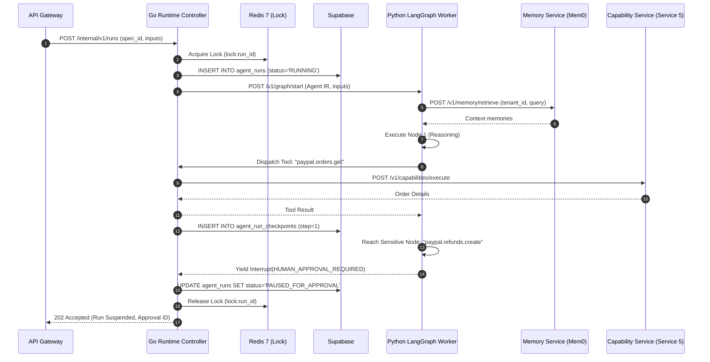

# Service 3 — Agent Runtime Service (`03-agent-runtime-service.md`)

## 1. Service Overview

The **Agent Runtime Service** is the execution engine of **DelTix**. It converts static, validated `Agent IR` specifications into active, stateful **LangGraph** workflows, manages node lifecycles, persists step checkpoints in **Supabase**, acquires distributed execution locks via **Redis**, queries the Memory Service for semantic context, coordinates human-in-the-loop approval pauses, and streams real-time execution events.

To balance Go's high-performance concurrency with LangGraph's native Python state graph ecosystem, the Runtime Service is implemented as a **dual-component hybrid**:
1. **Go Control-Plane Runtime (Go 1.23):** Owns API requests, tenant validation, Redis distributed locking, run state persistence in Supabase, tool dispatching to Service 5, and human approval resumption.
2. **Python LangGraph Execution Worker (Python 3.11):** An internal microservice executing the state graph, managing conditional edge routing, invoking node reasoning loops, and emitting telemetry to **LangSmith**.

---

## 2. Responsibility and Ownership

* **Agent IR Translation:** Translating JSON `Agent IR` nodes and transition edges into a compiled LangGraph `StateGraph`.
* **Stateful Orchestration:** Advancing the graph state through node evaluations, loops, and conditional edges.
* **Distributed Concurrency Control:** Acquiring and releasing Redis `redsync` distributed locks on `run_id` to guarantee zero concurrent conflicting runs.
* **Checkpoint Persistence:** Serializing step execution records, variables, and run statuses to Supabase after each step.
* **Human-in-the-Loop Interruption:** Halting graph execution upon encountering sensitive operations, generating an approval request, yielding resources, releasing Redis locks, and resuming from checkpoints upon approval.
* **Tool Invocation Routing:** Routing tool execution calls to the Capability & Policy Service (Service 5) with strict idempotency and policy checks.
* **Observability & Tracing:** Emitting step metrics and run spans to **LangSmith** and streaming real-time logs via Server-Sent Events (SSE).

---

## 3. Explicit Non-Responsibilities

* **No Natural Language Compilation:** The Runtime Service never compiles agent prompts or alters Agent IR schemas.
* **No Direct PayPal Sandbox Access:** The Runtime Service never speaks directly to PayPal APIs; all external interactions route through Service 5.
* **No Authoritative Balance Storage:** The Runtime Service does not manage customer accounts or financial ledgers; it tracks only execution state.

---

## 4. Internal Architecture

```text
[ API Gateway / Client Request: POST /v1/runs ]
                      │
                      ▼
┌────────────────────────────────────────────────────────┐
│  Go Control-Plane Runtime (Port 8082)                  │
│  - Verifies Readiness Token from agent_specs           │
│  - Acquires Redis Lock: lock:run_id (redsync)          │
│  - Creates Supabase agent_runs record (INITIALIZING)   │
│  - Manages Supabase Checkpoint Store                   │
└─────────────────────┬──────────────────────────────────┘
                      │ Internal gRPC Bridge (runtime.proto)
                      ▼
┌────────────────────────────────────────────────────────┐
│  Python LangGraph Execution Worker (Port 8085)         │
│  - Hydrates LangGraph StateGraph from Agent IR         │
│  - Executes Active Node (LLM / Tool / Process)         │
│  - Evaluates Conditional Branching & Loops             │
│  - Emits telemetry to LangSmith Cloud                  │
└──────────────┬───────────────────────────┬─────────────┘
               │                           │
       [ Tool Dispatch ]           [ Memory Context ]
               │                           │
               ▼                           ▼
    ┌────────────────────┐      ┌────────────────────┐
    │ Service 5:         │      │ Service 4:         │
    │ Capability & Policy│      │ Memory Service     │
    │ (PayPal Sandbox)   │      │ (Mem0 + Supabase)  │
    └────────────────────┘      └────────────────────┘
```

---

## 5. Main Components

1. **Go Run Coordinator (`runtime/coordinator.go`):** Validates run triggers, initializes run records in Supabase, and coordinates step dispatch.
2. **Redis Lock Manager (`runtime/lock.go`):** Implements Redsync distributed mutexes preventing duplicate simultaneous executions of a single run.
3. **LangGraph Worker Bridge (`runtime/worker_client.go`):** Sends step advancement commands to the internal Python worker over binary gRPC using `runtime.proto`.
4. **LangGraph StateGraph Builder (`worker/builder.py`):** Dynamically constructs Python LangGraph nodes and edges from `Agent IR` definitions.
5. **Supabase Checkpoint Manager (`runtime/checkpoint.go`):** Commits state snapshots to Supabase JSONB columns after every step.
6. **Interrupt & Resume Manager (`runtime/interrupt.go`):** Handles `interrupt()` signals, issues approval tokens, and coordinates state hydration on resumption.
7. **LangSmith Exporter (`worker/tracing.py`):** Enriches execution spans with `run_id`, `node_id`, and `tenant_id` for cloud observability.

---

## 6. Request and Response Contracts

### Trigger Run Contract
```json
{
  "spec_id": "spec_paypal_reconciliation_v1",
  "tenant_id": "tenant_acme_corp",
  "inputs": {
    "start_date": "2026-11-01T00:00:00Z",
    "end_date": "2026-11-05T23:59:59Z",
    "merchant_id": "M_12345678"
  }
}
```

### Pause for Approval Response (Status 202 Accepted)
```json
{
  "run_id": "run_01j7ax9k82m4",
  "status": "PAUSED_FOR_APPROVAL",
  "pending_approval": {
    "approval_id": "appr_77665544",
    "action": "paypal.refunds.create",
    "summary": "Issue refund of $45.00 USD for Transaction #TX-99881",
    "created_at": "2026-11-06T15:00:02Z"
  }
}
```

### Resume Interrupted Run Request
```json
{
  "approval_id": "appr_77665544",
  "approval_token": "atoken_99aabb88...",
  "decision": "APPROVED"
}
```

---

## 7. Database & Cache Ownership

* **Redis Keys Owned:** `lock:run_id` (Redsync distributed mutex).
* **Supabase Tables Owned:**
  * `agent_runs`: Tracks individual execution runs.
    * Columns: `run_id` (PK), `spec_id` (FK), `tenant_id`, `status` (INITIALIZING, RUNNING, PAUSED_FOR_APPROVAL, COMPLETED, FAILED, REJECTED), `current_step_index`, `state_payload` (JSONB), `final_output` (JSONB), `created_at`, `updated_at`.
  * `agent_run_checkpoints`: Granular step-by-step state snapshots for replay and fault tolerance.
    * Columns: `checkpoint_id` (PK), `run_id` (FK), `step_index`, `node_id`, `node_input` (JSONB), `node_output` (JSONB), `duration_ms`, `created_at`.

---

## 8. API Endpoints

| Method | Endpoint | Description |
| :--- | :--- | :--- |
| `POST` | `/internal/v1/runs` | Initializes and starts a new agent execution run. |
| `GET` | `/internal/v1/runs/{run_id}` | Retrieves execution state, status, and output from Supabase. |
| `POST` | `/internal/v1/runs/{run_id}/resume` | Resumes an interrupted run with a verified approval token. |
| `POST` | `/internal/v1/runs/{run_id}/abort` | Terminates a running or paused execution immediately. |
| `GET` | `/internal/v1/runs/{run_id}/checkpoints` | Returns historical step checkpoints for an execution. |

---

## 9. Error Handling

* **Step Timeout Handling:** If any single node execution exceeds `timeout_seconds` in the Agent IR, the step is aborted and routed to the node's configured fallback edge.
* **Worker Crash Recovery:** On Go service startup, a background sweep detects runs in `RUNNING` status without active worker heartbeats, reads the last checkpoint from Supabase `agent_run_checkpoints`, and resumes execution.
* **Loop Limits:** If loop iterations on a node exceed `max_loop_iterations`, the runtime terminates execution with `LOOP_LIMIT_EXCEEDED` to prevent infinite LLM billing.

---

## 10. Security Considerations

* **Readiness Enforcement:** The Runtime Service strictly verifies that the target `spec_id` possesses a valid, unrevoked `readiness_token` signed by Service 2. Unverified specs cannot run.
* **Memory Isolation:** Context queries to the Memory Service pass verified `tenant_id` claims, preventing cross-merchant data leakage.
* **Tool Invocation Policy:** All tool requests are routed through Service 5; the Runtime never runs arbitrary code or direct network calls.

---

## 11. Dependencies

* **Internal Services:** Capability & Policy Service (Service 5), Memory Service (Service 4).
* **Storage & Caching:** Supabase (PostgreSQL 16), Redis 7 (locks).
* **External Observability:** LangSmith (for trace logging and span telemetry).

---

## 12. Mermaid Sequence Diagram



---

## 13. Implementation Milestones

1. **Milestone 1:** Python LangGraph worker dynamic graph generator consuming Agent IR.
2. **Milestone 2:** Go Control-Plane HTTP server with Supabase run and checkpoint schema.
3. **Milestone 3:** Redis Redsync distributed lock manager.
4. **Milestone 4:** Tool callback bridge from Python worker to Go Service 5 client.
5. **Milestone 5:** State suspension and resumption mechanics for human approval.
6. **Milestone 6:** LangSmith tracing integration and real-time SSE streaming.

---

## 14. Testing Requirements

* **State Resumption Tests:** Simulating process kills during step execution and verifying state hydration from Supabase checkpoints.
* **Interrupt Verification Tests:** Ensuring graph execution completely yields when sensitive nodes are encountered.
* **Concurrency Tests:** Simulating simultaneous trigger requests on the same `run_id` and verifying Redis Redsync suppresses duplicates.
* **LangSmith Verification:** Ensuring span trees accurately reflect node hierarchy and latency.
