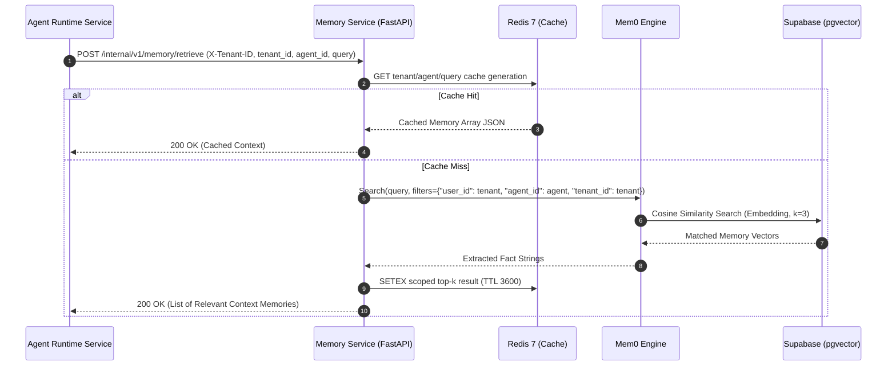

# Service 4 — Memory Service (`04-memory-service.md`)

## 1. Service Overview

The **Memory Service** provides long-term, semantic context management for **DelTix** using **Python 3.11 / FastAPI** and **Mem0**. While short-term execution state is tracked within LangGraph and Supabase, the Memory Service enables agents to retain merchant preferences, historical dispute patterns, and non-authoritative operational context across runs, backed by **Supabase pgvector** and cached in **Redis 7**.

Crucially, **Mem0 is used solely for unstructured semantic memory**. It is strictly decoupled from authoritative financial balances, transaction records, and approval state, which reside exclusively in Supabase transactional tables and the PayPal Developer Sandbox.

---

## 2. Responsibility and Ownership

* **Mem0 Integration:** Wrapping the Mem0 framework to provide structured semantic extraction, embedding generation, and vector retrieval.
* **Tenant & Agent Scoping:** Ensuring memories are partitioned strictly by `tenant_id` and `agent_id` in Supabase `pgvector` to prevent cross-tenant data leakage.
* **Context Retrieval & Caching:** Providing vector similarity search ($k=3..5$) for relevant historical context, caching top-k query hits in Redis.
* **Memory Invalidation & Pruning:** Pruning memories older than 90 days, updating superseded merchant preferences, and purging memories upon explicit user request.
* **Stable Internal Memory API:** Exposing clean REST contracts for ingestion, query, and maintenance.

---

## 3. Explicit Non-Responsibilities

* **No Authoritative Financial Records:** The Memory Service **never** stores bank balances, exact PayPal ledger amounts, or capture states.
* **No Approval State Storage:** The Memory Service does not manage human-in-the-loop approval tokens or permission grants.
* **No Workflow Execution:** The Memory Service does not orchestrate workflow steps or invoke tools.

---

## 4. Internal Architecture

The Memory Service is built in **Python 3.11 / FastAPI**, interfacing directly with the Mem0 SDK, Redis, and Supabase `pgvector`:

```text
[ Internal Runtime Service: POST /v1/memory/retrieve ]
                          │
                          ▼
┌────────────────────────────────────────────────────────┐
│  FastAPI Memory Controller (Port 8083)                 │
│  - Validates Internal Tenant Claims (X-Tenant-ID)      │
│  - Filters by agent_id and memory_namespace            │
└─────────────────────────┬──────────────────────────────┘
                          │
                          ▼
             [ Redis Top-K Query Cache ] ──Hit──► [ Return Cached Facts ]
                          │ Miss
                          ▼
┌────────────────────────────────────────────────────────┐
│  Mem0 Integration Engine                               │
│  - Text Embedding Generation (text-embedding-3-small)  │
│  - Deduplication & Conflict Resolution                 │
│  - Semantic Fact & Preference Extraction               │
└─────────────────────────┬──────────────────────────────┘
                          │
                          ▼
┌────────────────────────────────────────────────────────┐
│  Supabase (PostgreSQL 16 + pgvector)                   │
│  - Cosine Distance Search on Scoped Namespaces         │
│  - Metadata: {tenant_id, agent_id, timestamp, decay}   │
└────────────────────────────────────────────────────────┘
```

---

## 5. Main Components

1. **Memory Controller (`api/handlers.py`, `routes/routes.py`):** Exposes typed endpoints for memory addition, semantic search, deletion, and pruning.
2. **Mem0 Adapter (`services/memory_service.py`):** Configures Mem0 against Supabase `pgvector` and scopes operations by tenant and agent.
3. **Redis Memory Cache (`services/memory_service.py`):** Caches semantic search results with tenant-generation invalidation.
4. **PII Redaction (`services/memory_service.py`):** Removes card numbers, CVVs, and payment credentials before ingestion.
5. **Memory Pruner (`services/memory_service.py`):** Removes stale memories through the internal maintenance endpoint.

---

## 6. Request and Response Contracts

### Semantic Retrieval Request
```json
{
  "tenant_id": "tenant_acme_corp",
  "agent_id": "agent_paypal_reconciliation_v1",
  "query": "Historical discrepancies or customer dispute patterns for Merchant M_12345678",
  "limit": 3
}
```

### Semantic Retrieval Response
```json
{
  "memories": [
    {
      "id": "mem_01j7bx22",
      "text": "Merchant M_12345678 frequently experiences delayed batch capture settlements for recurring subscriptions.",
      "score": 0.89,
      "created_at": "2026-10-15T12:00:00Z"
    },
    {
      "id": "mem_01j7bx44",
      "text": "Operator prefers manual review for any discrepancy exceeding $20.00 USD.",
      "score": 0.84,
      "created_at": "2026-10-20T09:30:00Z"
    }
  ]
}
```

### Memory Storage Request (Post-Run Ingestion)
```json
{
  "tenant_id": "tenant_acme_corp",
  "agent_id": "agent_paypal_reconciliation_v1",
  "messages": [
    {"role": "user", "content": "Keep in mind that order batch #998 was delayed due to PayPal Sandbox maintenance."},
    {"role": "assistant", "content": "Noted. I will account for batch #998 maintenance in future reconciliation analyses."}
  ]
}
```

---

## 7. Database & Cache Ownership

* **Redis Keys Owned:** Tenant-generation keys and `memcache:{tenant_hash}:{agent_hash}:{generation}:{query_hash}` (TTL: 1 hour). A write, delete, purge, or prune advances the tenant generation to invalidate prior results.
* **Supabase Storage:** Mem0 owns its configured pgvector collection, `deltix_agent_memories`. It is deliberately separate from the shared relational migration, which drops the obsolete `mem0_memories` table.
  * Each Mem0 operation is scoped by `user_id=tenant_id` and `agent_id`; metadata also records both identifiers. Configure the vector-store connection through `MEMORY_DB_*`.

---

## 8. API Endpoints

| Method | Endpoint | Description |
| :--- | :--- | :--- |
| `POST` | `/internal/v1/memory/retrieve` | Semantic similarity query filtered by tenant and agent. |
| `POST` | `/internal/v1/memory/store` | Ingests conversational turns or facts into Mem0. |
| `DELETE`| `/internal/v1/memory/{memory_id}`| Invalidates or deletes a specific memory item. |
| `DELETE`| `/internal/v1/memory/tenant/{tenant_id}` | Complete tenant data purge (GDPR / compliance). |
| `POST` | `/internal/v1/memory/prune` | Deletes stale memories for the request tenant, optionally limited to an agent (up to 10,000 candidates per request). |

Every endpoint requires `X-Tenant-ID`. Store, retrieve, prune, and tenant-purge requests also carry `tenant_id`; it must match the header. Specific-memory deletion requires `agent_id` as a query parameter and only deletes a memory found in that tenant/agent scope. The header must be set by a trusted internal caller or gateway; it is not itself an authentication mechanism.

### Runtime configuration

Set `MEMORY_DB_HOST`, `MEMORY_DB_PORT` (default `5432`), `MEMORY_DB_USER`, `MEMORY_DB_PASSWORD`, and `MEMORY_DB_NAME` for the Supabase PostgreSQL connection, plus `OPENAI_API_KEY` for the default `text-embedding-3-small` embedder. PostgreSQL SSL defaults to `require` and can be changed with `MEMORY_DB_SSLMODE`. Optional settings include `REDIS_URL`, `MEMORY_SERVICE_PORT` (default `8083`), `MEMORY_COLLECTION_NAME`, `MEMORY_CACHE_TTL_SECONDS`, `MEMORY_DEFAULT_LIMIT`, `MEMORY_MAX_LIMIT`, `MEMORY_SIMILARITY_THRESHOLD`, and `MEMORY_RETENTION_DAYS` (default `90`). Redis may be omitted for local development; cache failures are logged and bypassed without affecting persisted memory operations.

---

## 9. Error Handling

* **Storage or Embedding Failure:** The service reports the dependency failure as an error; callers must decide whether to continue an agent run without memory. It does not convert failed retrieval into a success-shaped empty result.
* **Empty Match Handling:** If no memories exceed the similarity threshold (default `0.70`), an empty list is returned cleanly.

---

## 10. Security Considerations

* **Hard Tenant Namespace Partitioning:** All vector queries enforce an invariant `WHERE tenant_id == :tenant_id` filter at the database level.
* **PII Redaction:** Credit card numbers, CVVs, and sensitive payment tokens are stripped before embedding storage.
* **No Financial Authority:** System prompts explicitly instruct the LLM that semantic memories are informational context, not verified ledger facts.

---

## 11. Dependencies

* **External Frameworks:** Mem0 Python SDK (`mem0ai`).
* **Embedding Models:** OpenAI `text-embedding-3-small` or local embeddings.
* **Storage & Caching:** Supabase (`pgvector`), Redis 7.

---

## 12. Mermaid Sequence Diagram



---

## 13. Implementation Milestones

1. **Milestone 1:** FastAPI project scaffold with Mem0 SDK integration.
2. **Milestone 2:** Supabase `pgvector` extension setup and connection pooling.
3. **Milestone 3:** Redis top-k query cache integration.
4. **Milestone 4:** Tenant isolation layer and embedding generation pipeline.
5. **Milestone 5:** Scheduled internal caller for the `/prune` maintenance endpoint.

---

## 14. Testing Requirements

* **Isolation Tests:** Confirming that a memory stored for `tenant_A` is completely invisible to queries from `tenant_B`.
* **Cache Invalidation Tests:** Verifying that updating a memory invalidates the corresponding Redis cache key.
* **Degraded Mode Resilience:** Ensuring that if Mem0 is offline, Service 3 receives graceful fallback responses without throwing fatal errors.
