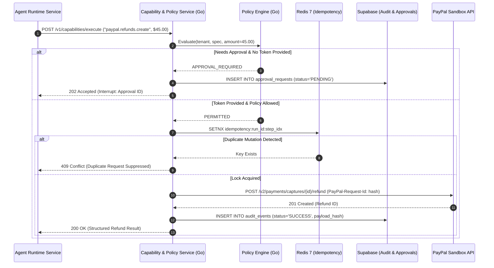

# Service 5 — Capability and Policy Service (`05-capability-and-policy-service.md`)

## 1. Service Overview

The **Capability and Policy Service** is the security gatekeeper and PayPal integration layer of **DelTix**. Written in **Go 1.23**, it maintains the immutable **Capability Registry**, enforces deterministic authorization and spending policies outside of the LLM, manages human approval tokens in **Supabase**, verifies deduplication and idempotency via **Redis 7**, and dispatches authenticated requests to the **PayPal Developer Sandbox**.

The LLM is strictly prohibited from making direct network calls to PayPal. Every financial interaction is mediated, validated, and logged by this service.

---

## 2. Responsibility and Ownership

* **Capability Registry Ownership:** Authoritative catalog of all executable tools, parameter schemas, timeouts, and sensitivity flags.
* **Deterministic Policy Enforcement:** Enforcing maximum spend limits (`max_budget_usd`), read-only restrictions, and tenant-level capability allowlists in Go.
* **Human-in-the-Loop Gatekeeping:** Detecting sensitive operations (e.g., captures, refunds), generating `approval_requests`, verifying approval tokens, and rejecting unapproved executions.
* **PayPal Developer Sandbox Integration:** Managing OAuth2 token lifecycles and executing typed HTTP requests against PayPal Sandbox APIs.
* **Payment Idempotency & Deduplication:** Leveraging Redis 7 to enforce `SETNX` distributed deduplication and injecting `PayPal-Request-Id` headers to prevent duplicate charges or double refunds.
* **Immutable Audit Trail:** Logging every capability invocation, input parameters, returned status, and policy decision to Supabase `audit_events`.

---

## 3. Explicit Non-Responsibilities

* **No Workflow Graph Planning:** The service does not decide the sequence of steps; it validates and executes individual tool calls requested by Service 3.
* **No Natural Language Processing:** The service contains zero LLM logic; all operations are deterministic Go code.
* **No Semantic Memory Management:** Does not manage unstructured conversational memory (owned by Service 4).

---

## 4. Internal Architecture

The service is engineered in **Go 1.23** with strict layer separation:

```text
[ Request from Runtime: POST /v1/capabilities/execute ]
                         │
                         ▼
┌────────────────────────────────────────────────────────┐
│  Capability Dispatcher & Schema Validator (Go)         │
│  - Verifies capability exists in Registry               │
│  - Validates input arguments against JSON Schema       │
└────────────────────────┬───────────────────────────────┘
                         │
                         ▼
┌────────────────────────────────────────────────────────┐
│  Deterministic Policy Engine (Go)                      │
│  - Checks Tenant Allowlist                             │
│  - Checks Agent Read-Only Invariant                    │
│  - Checks Spend Limit against cumulative run spend     │
└────────────────────────┬───────────────────────────────┘
                         │
                         ▼
          [ Sensitive Operation? ]
          ├── Yes & No Valid Token ──► [ Yield 202: Pause for Human Approval ]
          └── No OR Valid Token Present
                         │
                         ▼
┌────────────────────────────────────────────────────────┐
│  Redis Idempotency & OAuth2 Token Manager (Go)         │
│  - Redis SETNX idempotency:run_id:step_idx (TTL: 24h)  │
│  - Generates unique PayPal-Request-Id                  │
│  - Reuses valid Bearer Token / Refreshes via Client ID │
└────────────────────────┬───────────────────────────────┘
                         │
                         ▼
┌────────────────────────────────────────────────────────┐
│  Circuit Breaker & Reconcile-Before-Retry Layer (Go)   │
│  - sony/gobreaker (Fast-fail if PayPal 5xx >= 5)       │
│  - Automatic Query Verification Before Mutating Retry  │
└────────────────────────┬───────────────────────────────┘
                         │
                         ▼
┌────────────────────────────────────────────────────────┐
│  Typed PayPal Sandbox Adapters (Go HTTPS REST)         │
│  - Orders / Captures / Refunds / Transactions          │
└────────────────────────┬───────────────────────────────┘
                         │
                         ▼
┌────────────────────────────────────────────────────────┐
│  Append-Only Audit Logger (Supabase audit_events)      │
└────────────────────────────────────────────────────────┘
```

---

## 5. Main Components

1. **Capability Registry (`registry/catalog.go`):** In-memory immutable map of `ToolContract` definitions with precompiled Go JSON schemas.
2. **Policy Engine (`policy/evaluator.go`):** Evaluates spending caps, permission sets, and approval rules against agent metadata and run parameters.
3. **Approval Token Manager (`policy/approval.go`):** Generates cryptographically secure HMAC tokens for approval requests and verifies them on resumption.
4. **Redis Idempotency Manager (`policy/idempotency.go`):** Enforces atomic single-execution keys in Redis 7.
5. **Circuit Breaker Guard (`adapters/circuit_breaker.go`):** Wraps outbound calls using `sony/gobreaker` to trip on 5 consecutive failures, fast-failing calls for 30s to prevent worker starvation.
6. **Reconcile-Before-Retry Manager (`adapters/reconcile.go`):** Verifies capture/order status prior to re-attempting timed-out mutations to prevent double-charging.
7. **PayPal OAuth2 Client (`adapters/paypal_auth.go`):** Handles client-credentials token caching, thread-safe refreshes, and Sandbox endpoints.
8. **PayPal Adapters (`adapters/paypal_*.go`):** Typed Go clients for:
   * `OrdersAdapter`: `orders.create`, `orders.capture`, `orders.get`.
   * `PaymentsAdapter`: `captures.get`, `refunds.create`.
   * `TransactionsAdapter`: `transactions.list`.
9. **Supabase Audit Logger (`audit/logger.go`):** Records all requests and SHA-256 payload digests to the database.

---

## 6. Request and Response Contracts

### Capability Execution Request
```json
{
  "run_id": "run_01j7ax9k82m4",
  "tenant_id": "tenant_acme_corp",
  "capability_id": "paypal.refunds.create",
  "parameters": {
    "capture_id": "CAP-88776655",
    "amount": {
      "value": "45.00",
      "currency_code": "USD"
    },
    "note_to_payer": "Refund for damaged merchandise reported in dispute #998"
  },
  "approval_token": "atoken_99aabb88..." 
}
```

### Successful Tool Execution Response
```json
{
  "status": "SUCCESS",
  "capability_id": "paypal.refunds.create",
  "output": {
    "refund_id": "REFUND-11223344",
    "status": "COMPLETED",
    "amount": {"value": "45.00", "currency_code": "USD"},
    "create_time": "2026-11-06T15:01:00Z"
  },
  "audit_event_id": "audit_88990011"
}
```

### Policy Violation Response (HTTP 403 Forbidden)
```json
{
  "type": "https://deltix.dev/errors/policy-violation",
  "title": "Action Prohibited by Policy",
  "status": 403,
  "detail": "Agent spec 'agent_reconciliation_v1' is configured as read_only. Mutation tool 'paypal.refunds.create' is forbidden.",
  "code": "READ_ONLY_VIOLATION"
}
```

---

## 7. Database & Cache Ownership

* **Redis Keys Owned:** `idempotency:{run_id}:{step_index}` (TTL: 24 hours).
* **Supabase Tables Owned:**
  * `capability_registry`: Versioned capability metadata and parameter schemas.
  * `approval_requests`: Human approval records.
    * Columns: `approval_id` (PK), `run_id` (FK), `tenant_id`, `capability_id`, `requested_payload` (JSONB), `status` (PENDING, APPROVED, REJECTED, EXPIRED), `token_hash`, `approved_by`, `decision_reason`, `created_at`, `resolved_at`.
  * `audit_events`: Immutable audit trail.
    * Columns: `event_id` (PK), `run_id` (FK), `tenant_id`, `timestamp`, `capability_id`, `action_type`, `request_digest`, `response_digest`, `policy_result`, `ip_address`.

---

## 8. API Endpoints

| Method | Endpoint | Description |
| :--- | :--- | :--- |
| `POST` | `/internal/v1/capabilities/resolve` | Validates that a list of requested capabilities exist and are active. |
| `POST` | `/internal/v1/policies/validate` | Evaluates whether an Agent IR's policy block complies with tenant bounds. |
| `POST` | `/internal/v1/capabilities/execute` | Executes an authorized tool against PayPal Sandbox or internal adapters. |
| `POST` | `/internal/v1/approvals` | Creates a new human-in-the-loop approval request in Supabase. |
| `POST` | `/internal/v1/approvals/{id}/decision` | Submits operator decision (APPROVED/REJECTED) and issues resumption token. |
| `GET` | `/internal/v1/audit/runs/{run_id}` | Retrieves complete audit trail for an agent execution from Supabase. |

---

## 9. Error Handling

* **PayPal 5xx / Network Drop:** If PayPal Sandbox returns a 500 or 503, the adapter checks whether the operation is safe to retry. For mutations (charges/refunds), the adapter first queries PayPal using the idempotency key or capture ID to confirm transaction state before re-attempting.
* **PayPal 4xx (Client Error):** If PayPal returns a 400 (e.g., `CAPTURE_ALREADY_REFUNDED`), the error is normalized and returned to the runtime node without retry.

---

## 10. Security Considerations

* **Separation of Concerns:** Policy evaluation happens strictly in Go code before any network packet is dispatched to PayPal.
* **Credentials Kept Server-Side:** PayPal `client_id` and `client_secret` are injected via environment variables and never exposed to the client or LLM.
* **Tamper-Proof Approval Tokens:** Resumption tokens are signed using HMAC-SHA256 with an ephemeral salt; tokens cannot be forged or reused across different runs.

---

## 11. Dependencies

* **External Payment Provider:** PayPal Developer Sandbox (`https://api-m.sandbox.paypal.com`).
* **Storage & Caching:** Supabase (PostgreSQL 16 `audit_events`, `approval_requests`), Redis 7 (idempotency locks).

---

## 12. Mermaid Sequence Diagram



---

## 13. Implementation Milestones

1. **Milestone 1:** Capability registry catalog with schemas for all 6 PayPal MVP tools.
2. **Milestone 2:** Deterministic Go policy evaluation engine (spend limits, read-only guard).
3. **Milestone 3:** Redis idempotency key deduplication integration.
4. **Milestone 4:** PayPal Sandbox OAuth2 token manager and typed REST client adapters.
5. **Milestone 5:** Human approval token generator and resumption verification logic in Supabase.
6. **Milestone 6:** Append-only audit logger and query endpoints in Supabase.

---

## 14. Testing Requirements

* **Policy Enforcement Unit Tests:** 100% test coverage verifying that read-only violations, over-budget amounts, and unapproved sensitive calls return 403 Forbidden.
* **Idempotency Tests:** Verifying that repeated calls with identical idempotency headers do not trigger duplicate mutations.
* **Mock PayPal Sandbox Tests:** Comprehensive suite covering PayPal 200, 400, 401, 404, 422, and 503 response cases.
