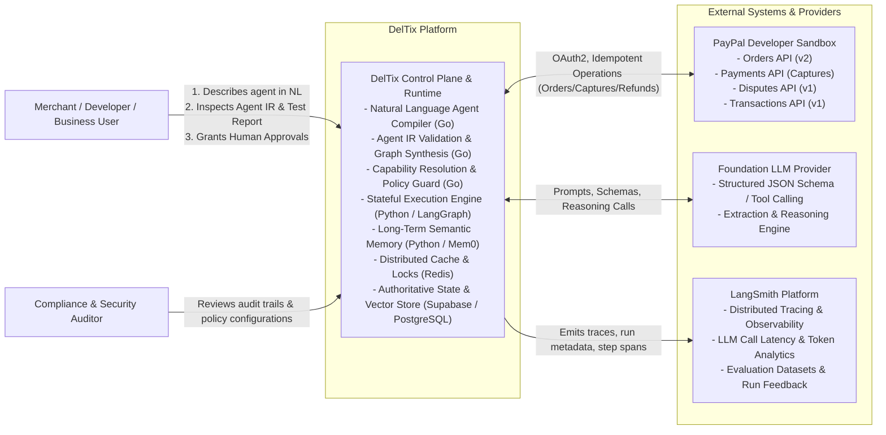

# 01 — System Context Diagram

This diagram visualizes the high-level system context for **DelTix**, showing interactions between users, the DelTix platform, PayPal Sandbox, foundation LLM providers, and LangSmith.

