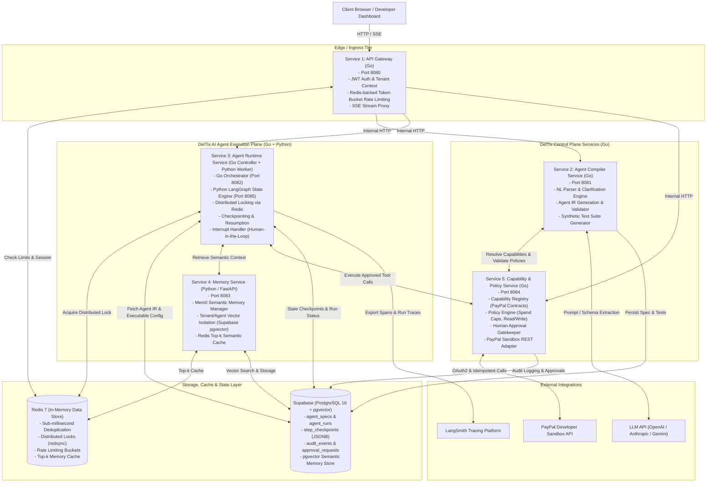

# 02 — Container Architecture Diagram

This diagram illustrates the container architecture of **DelTix**, detailing the Go control plane, Python execution plane, Redis caching/locking, Supabase database, and external providers.

