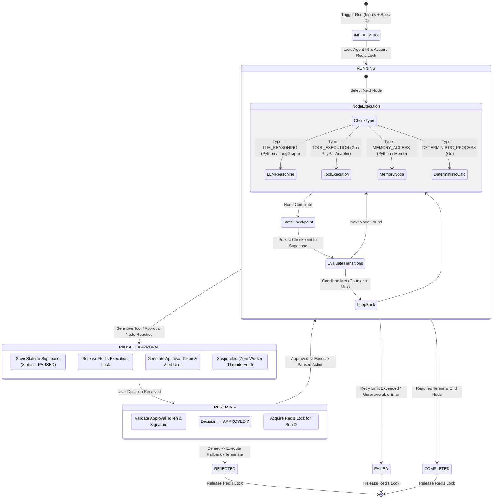

# 04 — Agent Execution Lifecycle Diagram

This state diagram details the runtime execution lifecycle in **DelTix**, covering node execution, state checkpointing in Supabase, Redis locking, and human-in-the-loop pauses.

