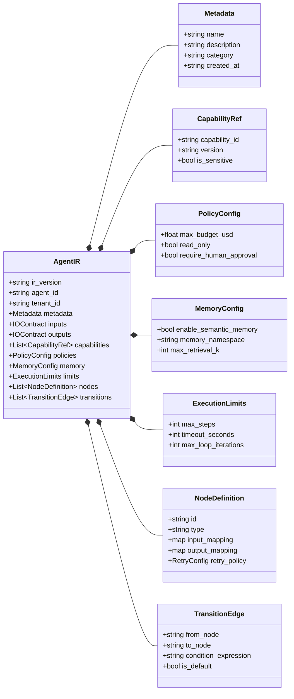

# 05 — Agent Intermediate Representation (Agent IR) Structure Diagram

This class diagram defines the data contracts and relationships within the **DelTix** Agent Intermediate Representation (`Agent IR v1.0`), oriented Left to Right.

