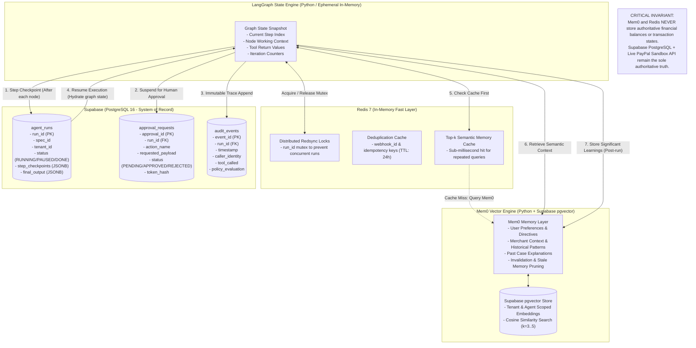

# 06 — Memory Architecture Diagram

This diagram visualizes the multi-tier memory architecture in **DelTix**, separating ephemeral execution state, Redis caching, Supabase authoritative state, and Mem0 semantic vectors.

