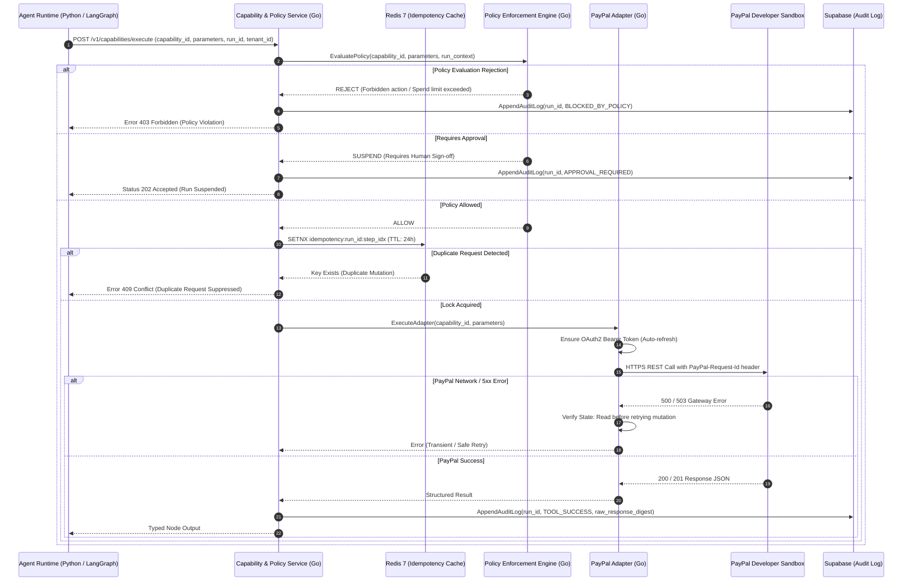

# 07 — PayPal Integration Flow Diagram

This sequence diagram details the controlled invocation flow from the LangGraph node through the Go Capability & Policy Service, Redis idempotency check, and the PayPal Developer Sandbox.

