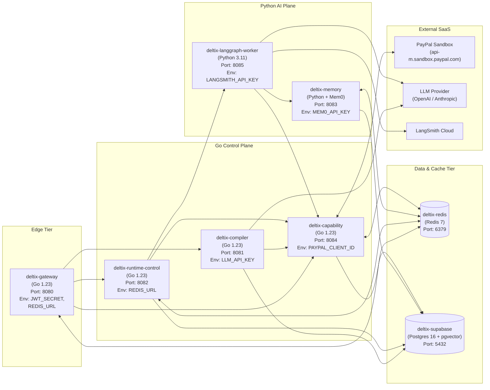

# 10 — Deployment Architecture Diagram

This diagram specifies the Docker-based local deployment topology for **DelTix** oriented Left to Right, detailing container names, images, exposed ports, networks, and environment bindings.

