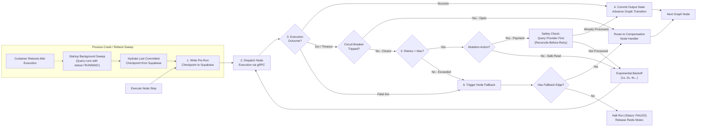

# 11 — Failure and Recovery Flow Diagram

This diagram visualizes failure detection, circuit breaker fast-failing, safe retry evaluations, reconcile-before-retry, and process crash recovery in **DelTix** oriented Left to Right.

