# DelTix — Master System Architecture Document
**High-Level Design (HLD) & Low-Level Design (LLD)**

* **Document Version:** 2.0.0
* **Target Audience:** Principal Architects, Systems Engineers, Security Auditors, Workstream Leads
* **Status:** Final Architectural Specification (Pre-Implementation Baseline)
* **Project Name:** **DelTix**
* **Tagline:** *Describe it. Generate it. Test it. Run it.*

---

# Part A — High-Level Design (HLD)

## 1. Project Overview & System Context

**DelTix** is an AI Agent Compiler and Runtime Platform engineered specifically for PayPal-powered financial operations. 

Traditional AI agent development forces engineering teams to repeatedly implement custom tool wrappers, volatile prompt templates, brittle state management, unverified permissions, and ad-hoc error handling for every new agent. DelTix replaces this fragmented workflow with an **agent engineering platform**. 

Developers describe a financial task in natural language. DelTix parses requirements, synthesizes a strongly typed **Agent Intermediate Representation (Agent IR)**, validates graph integrity, resolves capabilities against a registered catalog, enforces deterministic policies, executes synthetic test scenarios, and runs the validated agent on a shared, stateful runtime powered by **Go 1.23**, **Python 3.11 (LangGraph)**, **Mem0**, **Redis 7**, **Supabase (PostgreSQL 16 + pgvector)**, and the **PayPal Developer Sandbox**.

### System Context Diagram (HLD)

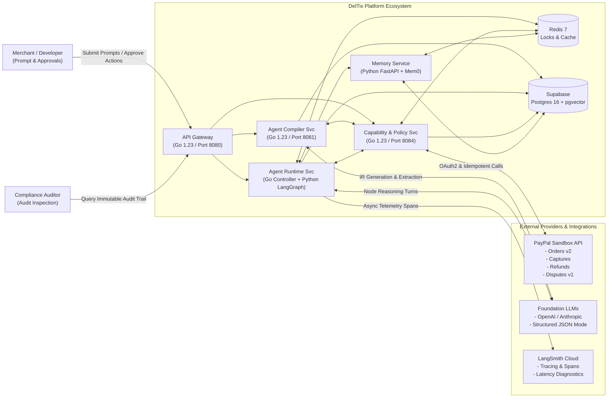

---

## 2. Problem Statement

Building production-grade AI agents in financial technology requires solving problems far beyond writing a prompt:
1. **Unbounded Execution & Hallucinated APIs:** Probabilistic LLMs invent endpoints, parameters, and execute arbitrary calls unless strictly bounded by deterministic schemas.
2. **Financial State Mutability & Double-Charging:** Retrying a timed-out network call without idempotency checks risks duplicate charges or multiple unauthorized refunds.
3. **Missing State & Brittle Resumption:** Financial workflows frequently require human authorization. Storing state in process memory prevents servers from rebooting or pausing cleanly while awaiting approvals.
4. **Unenforced Permissions Inside Prompts:** Prompts like *"Please do not issue refunds over $50"* can be bypassed via prompt injection. Permissions must be hardcoded outside the model in Go.
5. **No Standard Agent Specification:** Every agent is hand-coded as a bespoke microservice rather than compiled from a versioned, portable specification.

DelTix solves this by building the compiler and runtime infrastructure once, allowing diverse agents to be compiled, validated, and executed without writing custom backend code.

---

## 3. Product Goals and Non-Goals

### Product Goals
* **G1: Declarative Agent Specification:** Compile natural language into a versioned, reproducible Agent Intermediate Representation (`Agent IR v1.0`).
* **G2: Closed-World Capability Binding:** Resolve tools strictly against an immutable Capability Registry. Fictitious tools are rejected at compile time.
* **G3: Externalized Policy Enforcement:** Enforce spending caps, read-only constraints, and human-in-the-loop requirements in deterministic Go code outside the LLM.
* **G4: Test-Gated Agent Activation:** Prevent agent execution until positive, negative, and permission-breach synthetic tests pass.
* **G5: Resumable Execution Engine:** Execute agents on a Python LangGraph state machine supporting loops, conditional edges, interruptions for human approval, and zero-thread-loss pauses.
* **G6: Safe PayPal Sandbox Operations:** Provide typed, idempotent Go adapters for PayPal Sandbox (Orders, Captures, Refunds, Transactions).
* **G7: Low-Latency Distributed State:** Leverage Redis for sub-millisecond deduplication and redsync distributed locks, with Supabase as the ACID transactional source of truth.

### Product Non-Goals
* **NG1:** We are **not** building a general-purpose IDE or arbitrary code-execution sandbox.
* **NG2:** We are **not** building an autonomous live-money payment system. All transactions run on PayPal Sandbox.
* **NG3:** We are **not** training or fine-tuning foundation LLMs.
* **NG4:** We are **not** building a distributed workflow engine from scratch (we leverage LangGraph for state graph orchestration).
* **NG5:** We are **not** guaranteeing zero LLM hallucinations; we guarantee deterministic guardrails that prevent hallucinations from executing unauthorized actions.

---

## 4. Functional Requirements

* **FR1 (Natural Language Ingestion):** The system must accept free-form natural language and identify ambiguous or missing parameters (e.g. refund limits, human sign-off policies).
* **FR2 (Agent IR Synthesis & Validation):** The system must generate valid Agent IR, verify it against JSON Schema in Go, and validate graph topology (detect unreachable nodes, infinite cycles without exit, and dead ends).
* **FR3 (Capability Resolution):** The system must bind agent nodes to verified tools in the Capability Registry and reject unsupported capabilities.
* **FR4 (Deterministic Policy Checks):** The system must validate that proposed agent behaviors conform to tenant limits and mark sensitive nodes as approval-gated.
* **FR5 (Automated Synthetic Testing):** The compiler must generate and execute mock test suites (positive, negative, and fault-injection) before marking an agent as executable.
* **FR6 (Human-in-the-Loop Interruption):** The runtime must suspend execution when a sensitive capability is invoked, issue an approval request, persist state to Supabase, release Redis locks, and resume upon approval.
* **FR7 (PayPal Sandbox Integration):** The platform must execute typed operations against PayPal Sandbox using OAuth2 credentials and `PayPal-Request-Id` idempotency headers.
* **FR8 (Memory Retrieval & Persistence):** The system must use Mem0 for long-term semantic context and Supabase for transactional state and audit trails.

---

## 5. Non-Functional Requirements

* **NFR1 (Deterministic Safety):** 100% of capability invocations must pass deterministic authorization checks before network dispatch.
* **NFR2 (Execution Idempotency):** Every mutation call to PayPal must carry a cryptographically unique idempotency key registered in Redis and Supabase; duplicate executions must be rejected.
* **NFR3 (Resumability & Durability):** 100% of workflow step transitions must be checkpointed to Supabase. Zero in-flight runs may be lost on worker crash.
* **NFR4 (Auditability):** Every LLM prompt, capability input, capability output, policy check, and human approval must be recorded in an append-only Supabase audit table.
* **NFR5 (Tenant Isolation):** Strict multi-tenant data partitioning across Supabase PostgreSQL records and Mem0 vector namespaces.

---

## 6. End-to-End Container & Network Topology (HLD)

DelTix is partitioned into an **Edge Tier**, a **Go Control Plane**, a **Python AI Execution Plane**, and a **Storage Tier**.

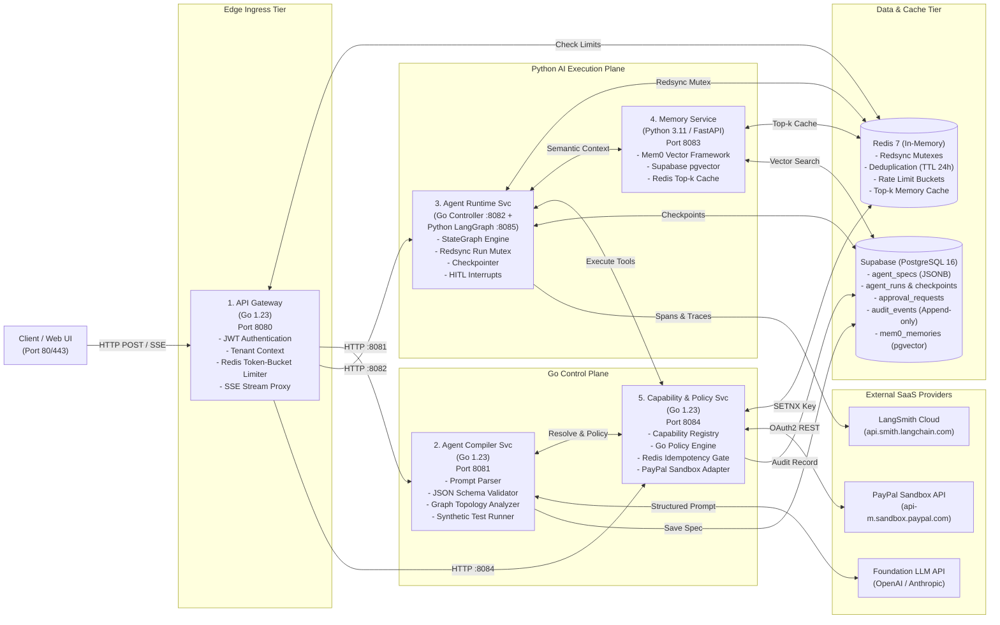

---

## 7. Component Responsibilities

| Service | Primary Technology | Core Architectural Responsibilities |
| :--- | :--- | :--- |
| **1. API Gateway** | **Go 1.23** | Ingress TLS termination, JWT verification, tenant context injection, Redis token-bucket rate limiting, reverse proxy routing, and real-time SSE streaming. |
| **2. Agent Compiler Service** | **Go 1.23** | Natural-language prompt parsing, clarification dialog generation, `Agent IR v1.0` JSON Schema validation, graph cycle & reachability analysis, synthetic test generation, and Supabase spec persistence. |
| **3. Agent Runtime Service** | **Go 1.23 + Python 3.11 (LangGraph)** | Dual-component execution engine. Go controller manages Redis Redsync run mutexes and Supabase checkpoints. Python LangGraph worker drives dynamic state graph execution, conditional edges, loops, and human-in-the-loop interruptions. |
| **4. Memory Service** | **Python 3.11 / FastAPI (Mem0)** | Long-term semantic memory, merchant preference extraction, cosine similarity vector search over Supabase `pgvector`, and Redis top-k caching. |
| **5. Capability & Policy Service** | **Go 1.23** | Immutable Capability Registry, deterministic Go spending limits and read-only policy evaluation, Redis `SETNX` idempotency keys, human approval token generation, and typed PayPal Sandbox adapters. |

---

## 8. Service Boundaries & Interaction Matrix (HLD)

The five services maintain strict, non-overlapping ownership boundaries. Communication is governed by versioned REST contracts over internal Docker networks:

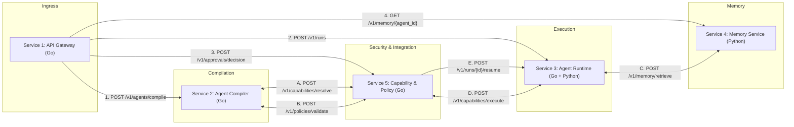

---

## 9. External Integrations

| Provider | Purpose | Authentication | Protocol | Failure Semantics |
| :--- | :--- | :--- | :--- | :--- |
| **PayPal Developer Sandbox** | Payment operations (Orders, Captures, Refunds, Transactions) | OAuth2 Client Credentials (Bearer Token) | HTTPS REST (`api-m.sandbox.paypal.com`) | Idempotent retries on 5xx; non-retryable on 4xx. |
| **Foundation LLM Provider** | Intent extraction, Agent IR generation, and node reasoning | API Key (Server-side environment) | HTTPS REST (JSON Schema / Tool Calling) | Exponential backoff on rate limits (429). |
| **LangSmith** | Distributed tracing, evaluation, and latency profiling | `LANGSMITH_API_KEY` | HTTPS REST (Asynchronous background exporter) | Non-blocking telemetry drop on failure. |

---

## 10. Main Data Flows

### A. Agent Compilation Data Flow (HLD)

```mermaid
flowchart LR
    NLPrompt["1. User Prompt in NL\n(e.g., 'Reconcile dispute items')"] --> Extraction["2. LLM Intent Extraction\n(Structured JSON Output)"]
    
    Extraction --> ClarifyCheck{"3. Ambiguities\nDetected?"}
    ClarifyCheck -->|Yes| ClarifyDialog["Emit Clarification Dialog\nto User via Gateway"]
    ClarifyDialog --> NLPrompt
    
    ClarifyCheck -->|No| IRSynthesis["4. Agent IR Synthesis\n(Draft Specification)"]
    IRSynthesis --> SchemaValidator["5. Go JSON Schema\nValidator (agent_ir_v1)"]
    
    SchemaValidator --> TopologyAnalyzer["6. Go Graph DFS Analyzer\n(Detect Cycles & Dead Ends)"]
    TopologyAnalyzer --> CapResolver["7. Capability Resolution\n(Query Service 5 Catalog)"]
    
    CapResolver --> PolicyGate["8. Policy Engine Verification\n(Check Limits & Read-Only)"]
    PolicyGate --> TestSuite["9. Synthetic Test Suite\n(Positive, Negative, Breach)"]
    
    TestSuite --> MockSandbox["10. Mock Execution Harness\n(Pre-flight Validation)"]
    MockSandbox --> SupabaseSpec[("11. Persist to Supabase\n(agent_specs Table)")]
```

### B. Agent Runtime Execution & Human Approval Sequence (HLD)

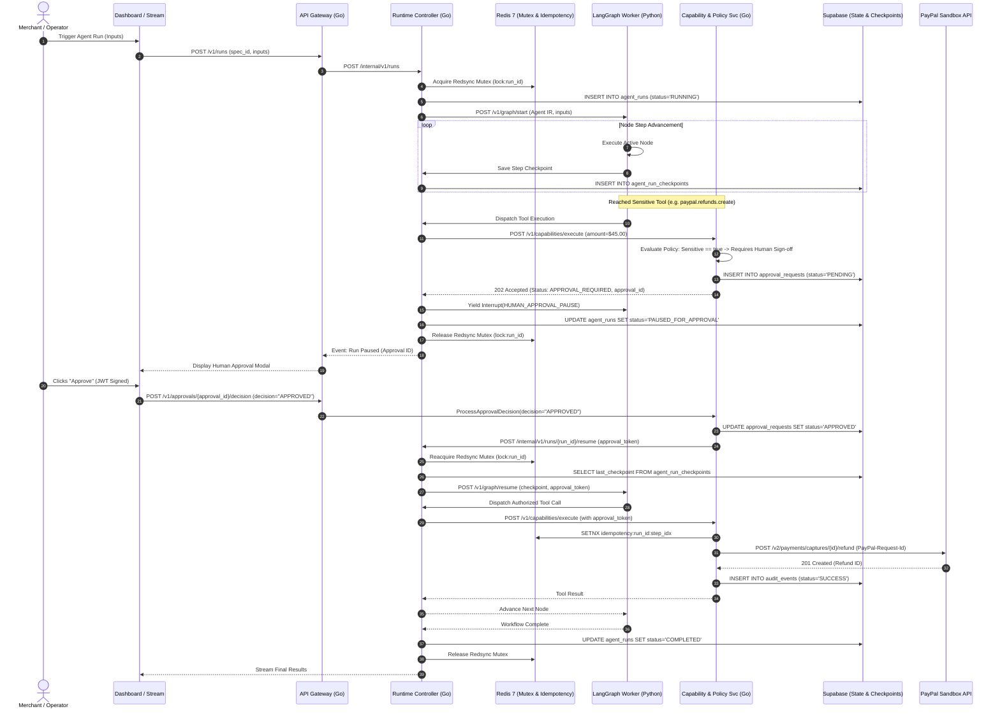

---

## 11. Security & Externalized Policy Guard (HLD)

DelTix guarantees that **the LLM cannot grant itself permissions or bypass security policies**. Every capability execution requested by an agent must pass through the deterministic Go Policy Engine:

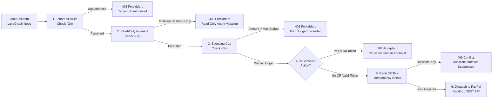

---

## 12. Local Deployment Architecture (HLD)

DelTix is packaged for reproducible local deployment using Docker Compose on an isolated bridge network (`deltix-net`).

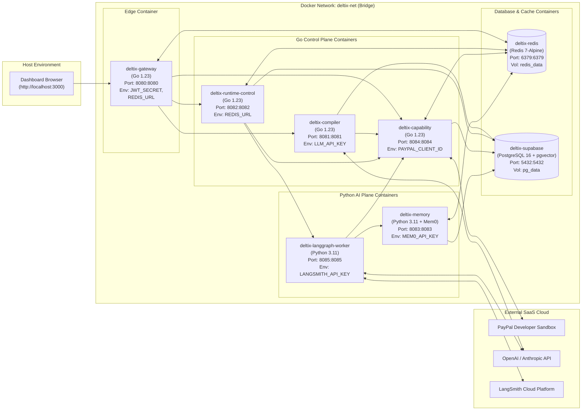

---

## 13. Resilience, Circuit Breakers, gRPC & Safe Retries (HLD)

Building reliable financial agents requires strict resilience primitives. DelTix implements **Circuit Breakers**, **gRPC binary bridges**, **safe mutation retries**, and **deterministic fallback routing**:

### A. Circuit Breaker Architecture (PayPal & LLM Guard)
External provider downtime (e.g. PayPal Sandbox maintenance or LLM 429 rate limits) must not freeze worker threads or deplete token budgets. DelTix embeds the **Circuit Breaker pattern** in Go (using `sony/gobreaker`):

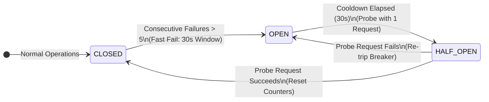

* **CLOSED:** Standard state. Outbound requests flow to PayPal Sandbox and LLM providers.
* **OPEN:** If 5 consecutive failures or 5xx timeouts occur, the breaker trips. For the next 30 seconds, all subsequent requests **fail immediately** with `503 Service Degraded`, bypassing external network calls, preserving LLM token quota, and protecting connection pools.
* **HALF-OPEN:** After the 30-second cooldown, the breaker allows a single probe request through. If it succeeds, the breaker resets to `CLOSED`. If it fails, it returns to `OPEN` for another 30 seconds.

### B. Protocol Strategy: Where gRPC vs REST is Used
DelTix applies a hybrid protocol design tailored to performance and ergonomics:

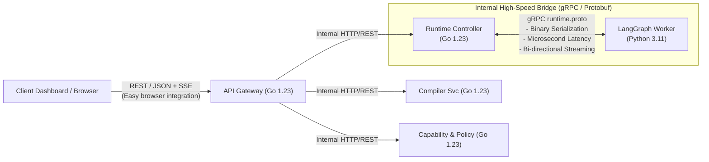

* **Client ⟷ Edge:** **REST + SSE** (Server-Sent Events) is used for dashboard clients because browsers natively support HTTP/JSON and EventSource streaming without custom WASM/gRPC-Web proxies.
* **Go Control Plane ⟷ Python LangGraph Worker:** **gRPC with Protobuf (`runtime.proto`)** is used for internal agent execution. Passing graph state dictionaries, step commands, and LangSmith spans between Go and Python via binary Protobuf eliminates JSON serialization bottlenecks and enforces strict multi-language compile-time type safety.
* **Internal Go Services:** Lightweight **HTTP/REST** for simplicity and independent container debugging.

### C. Safe Retries vs The Financial Mutation Trap
In financial workflows, blindly retrying a failed or timed-out request is dangerous. DelTix enforces a strict distinction:
1. **Idempotent Read Operations (`paypal.orders.get`, `paypal.transactions.list`, `llm.reasoning`):**
   * Automatically retried with **Exponential Jittered Backoff** (1s, 2s, 4s...) up to `max_retries`.
2. **Mutating Financial Operations (`paypal.orders.capture`, `paypal.refunds.create`):**
   * **The Financial Trap:** If a network drop occurs after PayPal processes a capture but before DelTix receives the response, blindly retrying could double-charge the merchant!
   * **The DelTix Safety Protocol:** 
     1. Injects `PayPal-Request-Id: hash(run_id + step_idx)`.
     2. Enforces **Reconcile-Before-Retry**: Before attempting a second dispatch, the adapter automatically queries `paypal.orders.get` or `paypal.captures.get`. If PayPal already recorded the transaction as completed, DelTix recovers the existing ID and marks the step succeeded without issuing a second payment mutation.

### D. Fallback Routing in Agent IR
If retries are exhausted or the Circuit Breaker is tripped, the execution graph does not crash. Every node in the `Agent IR` supports an explicit fallback transition:
* If `paypal.orders.get` fails 3 times ➡️ Graph routes to `node_alert_operator`, transitioning run status cleanly to `PAUSED_FOR_APPROVAL` or generating an error diagnosis report for operator review.

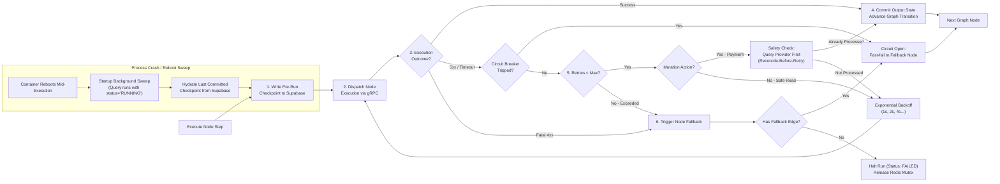

---

# Part B — Low-Level Design (LLD)

## 1. Agent Intermediate Representation (Agent IR) Structural Model

The `Agent IR v1.0` is the canonical, versioned specification representing an executable agent. It is completely decoupled from any single LLM or programming language.

### Detailed Class & Entity Contract Diagram (LLD)

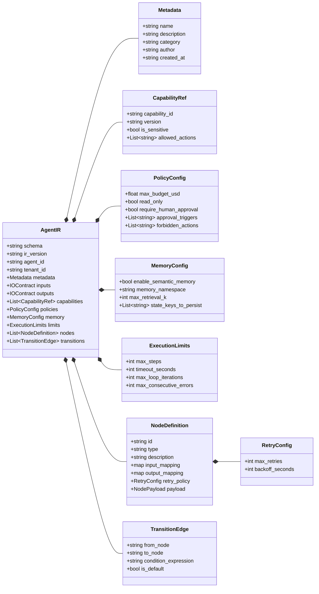

### Complete JSON Schema Reference Example: Payment Reconciliation Agent
```json
{
  "$schema": "https://deltix.dev/schemas/agent_ir_v1.json",
  "ir_version": "1.0.0",
  "agent_id": "agent_paypal_reconciliation_v1",
  "tenant_id": "tenant_merchant_acme_corp",
  "metadata": {
    "name": "Payment Reconciliation Agent",
    "description": "Cross-references PayPal transactions with order records, identifies discrepancy amounts, and drafts an audit report.",
    "category": "reconciliation",
    "author": "compiler_engine",
    "created_at": "2026-11-06T15:00:00Z"
  },
  "inputs": {
    "start_date": {"type": "string", "format": "date-time", "required": true},
    "end_date": {"type": "string", "format": "date-time", "required": true},
    "merchant_id": {"type": "string", "required": true}
  },
  "outputs": {
    "reconciliation_status": {"type": "string", "enum": ["MATCHED", "DISCREPANCY_FOUND", "ERROR"]},
    "discrepancy_count": {"type": "integer"},
    "report_summary": {"type": "string"},
    "discrepancy_details": {"type": "array"}
  },
  "capabilities": [
    {
      "capability_id": "paypal.transactions.list",
      "version": "1.0.0",
      "is_sensitive": false,
      "allowed_actions": ["READ"]
    },
    {
      "capability_id": "paypal.orders.get",
      "version": "1.0.0",
      "is_sensitive": false,
      "allowed_actions": ["READ"]
    }
  ],
  "policies": {
    "read_only": true,
    "max_budget_usd": 0.00,
    "require_human_approval": false,
    "forbidden_actions": ["paypal.refunds.create", "paypal.orders.capture"]
  },
  "memory": {
    "enable_semantic_memory": true,
    "memory_namespace": "tenant_merchant_acme_corp/reconciliation",
    "max_retrieval_k": 3,
    "state_keys_to_persist": ["transactions", "orders", "discrepancies"]
  },
  "execution_limits": {
    "max_steps": 25,
    "timeout_seconds": 120,
    "max_loop_iterations": 5,
    "max_consecutive_errors": 2
  },
  "nodes": [
    {
      "id": "node_fetch_transactions",
      "type": "TOOL_EXECUTION",
      "description": "Fetch transaction records from PayPal Sandbox for the date range",
      "input_mapping": {
        "start_time": "inputs.start_date",
        "end_time": "inputs.end_date"
      },
      "payload": {
        "capability_id": "paypal.transactions.list"
      },
      "output_mapping": {
        "raw_transactions": "result.transaction_details"
      },
      "retry_policy": {"max_retries": 3, "backoff_seconds": 2}
    },
    {
      "id": "node_fetch_orders",
      "type": "TOOL_EXECUTION",
      "description": "Fetch corresponding internal/sandbox orders for comparison",
      "input_mapping": {
        "transaction_ids": "state.raw_transactions[*].transaction_info.transaction_id"
      },
      "payload": {
        "capability_id": "paypal.orders.get"
      },
      "output_mapping": {
        "orders": "result.order_records"
      },
      "retry_policy": {"max_retries": 3, "backoff_seconds": 2}
    },
    {
      "id": "node_calculate_discrepancies",
      "type": "DETERMINISTIC_PROCESS",
      "description": "Deterministic balance comparison between captured transaction amounts and order totals",
      "input_mapping": {
        "transactions": "state.raw_transactions",
        "orders": "state.orders"
      },
      "payload": {
        "operation": "BALANCE_DIFF_CALCULATION",
        "tolerance_cents": 0
      },
      "output_mapping": {
        "discrepancies": "result.diff_items",
        "discrepancy_count": "result.total_diffs"
      }
    },
    {
      "id": "node_check_discrepancy_count",
      "type": "CONDITIONAL_ROUTER",
      "description": "Route based on whether discrepancies were found",
      "payload": {
        "condition_type": "EXPRESSION",
        "expression": "state.discrepancy_count > 0"
      }
    },
    {
      "id": "node_generate_discrepancy_report",
      "type": "LLM_REASONING",
      "description": "Use LLM to synthesize discrepancy notes citing specific order IDs and timestamps",
      "input_mapping": {
        "discrepancies": "state.discrepancies"
      },
      "payload": {
        "prompt_template": "Analyze the following discrepancy items and generate a clear merchant explanation: {{state.discrepancies}}",
        "temperature": 0.1
      },
      "output_mapping": {
        "report_summary": "result.text_summary",
        "reconciliation_status": "'DISCREPANCY_FOUND'"
      }
    },
    {
      "id": "node_generate_clean_report",
      "type": "DETERMINISTIC_PROCESS",
      "description": "Output clean matched report when zero discrepancies are detected",
      "payload": {
        "static_output": {
          "report_summary": "All transactions perfectly match corresponding orders. Zero variance detected.",
          "reconciliation_status": "MATCHED"
        }
      },
      "output_mapping": {
        "report_summary": "result.report_summary",
        "reconciliation_status": "result.reconciliation_status"
      }
    }
  ],
  "transitions": [
    {
      "from_node": "node_fetch_transactions",
      "to_node": "node_fetch_orders",
      "is_default": true
    },
    {
      "from_node": "node_fetch_orders",
      "to_node": "node_calculate_discrepancies",
      "is_default": true
    },
    {
      "from_node": "node_calculate_discrepancies",
      "to_node": "node_check_discrepancy_count",
      "is_default": true
    },
    {
      "from_node": "node_check_discrepancy_count",
      "to_node": "node_generate_discrepancy_report",
      "condition_expression": "state.discrepancy_count > 0",
      "is_default": false
    },
    {
      "from_node": "node_check_discrepancy_count",
      "to_node": "node_generate_clean_report",
      "condition_expression": "state.discrepancy_count == 0",
      "is_default": true
    }
  ]
}
```

---

## 2. Compiler Internal Pipeline (LLD)

The compilation pipeline converts unconstrained text into a cryptographically signed, executable spec across 9 deterministic and probabilistic stages:

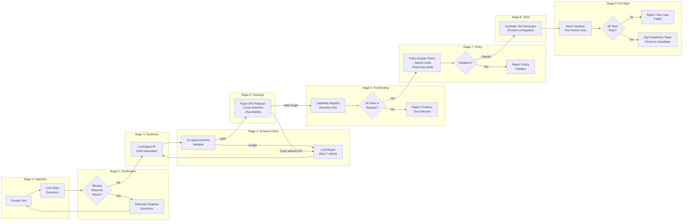

---

## 3. Runtime Engine & State Machine (LLD)

### State Machine Lifecycle Transition Graph (LLD)

```mermaid
stateDiagram-v2
    direction LR
    [*] --> INITIALIZING: Trigger Run Triggered
    INITIALIZING --> RUNNING: Acquire Redsync Mutex & Load IR
    
    state RUNNING {
        direction LR
        SelectNode --> ExecuteNode: Node Handler
        ExecuteNode --> SaveCheckpoint: Commit to Supabase
        SaveCheckpoint --> EvaluateEdge: Check Edge Expression
        EvaluateEdge --> SelectNode: Next Node Found
    }
    
    RUNNING --> PAUSED_APPROVAL: Sensitive Tool Node Reached
    
    state PAUSED_APPROVAL {
        direction LR
        PersistState --> ReleaseRedsyncMutex
        ReleaseRedsyncMutex --> AwaitHumanSignoff
    }
    
    PAUSED_APPROVAL --> RESUMING: Decision Received via API
    
    state RESUMING {
        direction LR
        ValidateToken --> ReacquireRedsyncMutex
        ReacquireRedsyncMutex --> HydrateCheckpoint
    }
    
    RESUMING --> RUNNING: Decision == APPROVED
    RESUMING --> REJECTED: Decision == REJECTED
    
    RUNNING --> FAILED: Retry Exhausted / Timeout
    RUNNING --> COMPLETED: Reached Terminal End Node
    
    REJECTED --> [*]: Release Redis Lock
    FAILED --> [*]: Release Redis Lock
    COMPLETED --> [*]: Release Redis Lock
```

### Go Controller to Python LangGraph gRPC Bridge Protocol (LLD)

The internal execution bridge between the Go Control Plane and the Python LangGraph Worker operates over high-speed binary **gRPC**:

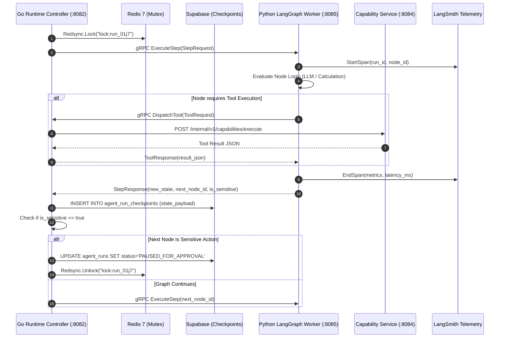

#### Protocol Buffer Contract: `runtime.proto`
```protobuf
syntax = "proto3";

package deltix.runtime.v1;

option go_package = "github.com/deltix/runtime/v1/pb;runtimev1";

service AgentExecutionService {
  // Executes a single workflow step or sub-graph turn
  rpc ExecuteStep (StepRequest) returns (StepResponse);
  
  // Resumes an interrupted run with a verified approval token
  rpc ResumeExecution (ResumeRequest) returns (StepResponse);
  
  // Callback stream from Python worker to Go host for tool execution
  rpc DispatchTool (ToolRequest) returns (ToolResponse);
}

message StepRequest {
  string run_id = 1;
  string tenant_id = 2;
  string node_id = 3;
  string state_json = 4;
  string agent_ir_json = 5;
}

message StepResponse {
  string run_id = 1;
  string completed_node_id = 2;
  string next_node_id = 3;
  string updated_state_json = 4;
  bool is_interrupted = 5;
  string interrupt_reason = 6;
  bool is_terminal = 7;
}

message ResumeRequest {
  string run_id = 1;
  string approval_token = 2;
  string decision = 3; // "APPROVED" or "REJECTED"
  string state_checkpoint_json = 4;
}

message ToolRequest {
  string run_id = 1;
  string capability_id = 2;
  string parameters_json = 3;
}

message ToolResponse {
  bool success = 1;
  string result_json = 2;
  string error_message = 3;
}
```

---

## 4. Multi-Tier Memory Subsystem (LLD)

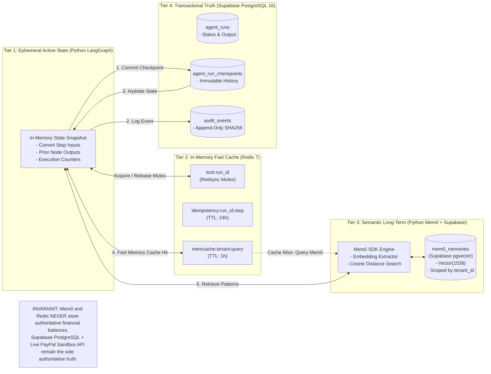

---

## 5. Capability Registry & PayPal Adapters (LLD)

Every tool in DelTix is mediated by typed Go contracts and executed exclusively through official PayPal Sandbox REST endpoints:

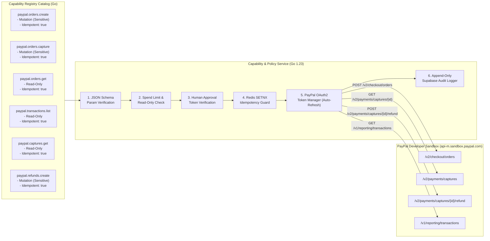

### Go Circuit Breaker & Reconcile-Before-Retry Implementation (LLD)

```go
package adapters

import (
    "context"
    "fmt"
    "time"
    "github.com/sony/gobreaker"
)

type PayPalAdapter struct {
    cb     *gobreaker.CircuitBreaker
    client *PayPalHTTPClient
}

func NewPayPalAdapter(client *PayPalHTTPClient) *PayPalAdapter {
    settings := gobreaker.Settings{
        Name:        "PayPal-Sandbox-Breaker",
        MaxRequests: 3,                // Max half-open probe requests
        Interval:    60 * time.Second, // Cyclic failure count window
        Timeout:     30 * time.Second, // Open cooldown duration
        ReadyToTrip: func(counts gobreaker.Counts) bool {
            return counts.ConsecutiveFailures >= 5
        },
    }
    return &PayPalAdapter{
        cb:     gobreaker.NewCircuitBreaker(settings),
        client: client,
    }
}

// ExecuteWithCircuitBreaker wraps PayPal API calls with Circuit Breaker & Idempotent Safety
func (a *PayPalAdapter) CreateRefund(ctx context.Context, captureID string, amount float64, idempKey string) (*RefundResult, error) {
    result, err := a.cb.Execute(func() (interface{}, error) {
        // Step 1: Attempt Refund with Idempotency Key
        res, err := a.client.PostRefund(ctx, captureID, amount, idempKey)
        if err != nil && isNetworkTimeout(err) {
            // Step 2: The Golden Rule: Reconcile-Before-Retry
            // Query capture details to verify if PayPal processed the refund during timeout
            capture, queryErr := a.client.GetCapture(ctx, captureID)
            if queryErr == nil && capture.RefundedAmount >= amount {
                return &RefundResult{Status: "ALREADY_COMPLETED", RefundID: capture.LatestRefundID}, nil
            }
            return nil, fmt.Errorf("transient timeout on refund, reconciliation pending: %w", err)
        }
        return res, err
    })

    if err != nil {
        return nil, fmt.Errorf("paypal adapter execution failed: %w", err)
    }
    return result.(*RefundResult), nil
}
```

---

## 6. Complete Human-in-the-Loop Interruption Sequence (LLD)

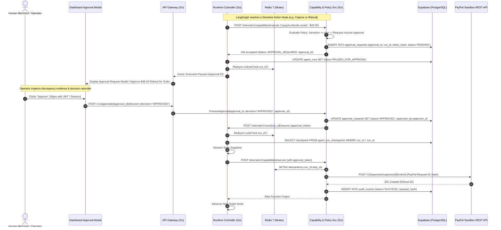
