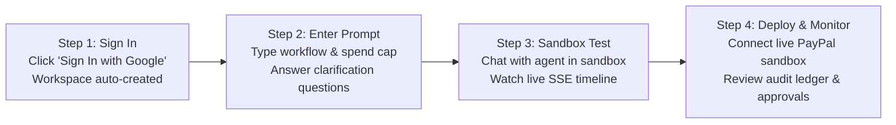

# DelTix — End-User Product Guide & UI Component Manual (`docs.md`)

**Product:** DelTix — Financial AI Agent Compiler & Runtime Platform  
**Document Purpose:** Complete End-User (Client) Guide & Production UI Walkthrough  
**Audience:** FinTech Operators, Financial Engineers, Compliance Officers, Startup Clients

---

## Welcome to DelTix

DelTix allows businesses to build, test, and deploy **autonomous financial AI agents** connected directly to PayPal, bank payouts, and ERP systems without the fear of LLM hallucinations or unauthorized money movement.

This document walks through **every screen, button, input, and workflow** in the DelTix web application, explaining exactly how a client uses the platform from landing to production settlement.

---

## 1. Screen 1: Public Landing Page (`/`)

The first page a prospective client or team member sees when visiting your startup.

```
┌────────────────────────────────────────────────────────────────────────────────────────┐
│ [Logo] DelTix           Platform   Guardrails   Pricing   Docs     [Sign In with Google] │
├────────────────────────────────────────────────────────────────────────────────────────┤
│                                                                                        │
│     Autonomous Financial AI Agents with Zero Hallucinations                            │
│     Compile natural language into mathematically verified payment workflows.           │
│                                                                                        │
│     [ Enter Studio (Free Sandbox) ]            [ Book Enterprise Demo ]                │
│                                                                                        │
│ ────────────────────────────────────────────────────────────────────────────────────── │
│ INTERACTIVE HERO PLAYGROUND (Try Before Login):                                         │
│                                                                                        │
│ 1. Type a sample prompt:                                                               │
│    [ "Refund e-commerce orders under $50 automatically via PayPal; escalate >$50"    ] │
│                                                                                        │
│ 2. Live Guardrail Verification Preview:                                                │
│    [✓] Graph Cycle Detection: Safe DAG (0 Infinite Loops)                              │
│    [✓] Deterministic Math AST: Python Decimal Enabled (0 Floating-Point Errors)        │
│    [✓] Spend Policy Engine: Max Cap $500.00 / Human Gate at $50.00                     │
│    [✓] PII Redaction: Payment Cards & Tokens Auto-Sanitized                            │
│                                                                                        │
└────────────────────────────────────────────────────────────────────────────────────────┘
```

### UI Components on This Screen:
1. **Top Navigation Bar:**
   - **Logo:** Returns to home.
   - **Navigation Links:** Smooth scroll to *Platform*, *Guardrails*, *Pricing*, and *Docs*.
   - **`[Sign In with Google]` Button:** Launches Google OAuth 2.0 with one-click workspace account creation.
2. **Hero Call-to-Actions (CTAs):**
   - **`[Enter Studio]` Button:** Takes authenticated users straight to their compiler workspace.
   - **`[Book Enterprise Demo]` Button:** Opens a Calendly modal for institutional accounts.
3. **Interactive Hero Playground Widget:**
   - A live demo sandbox where clients can click pre-written prompt pills (*"Vendor Invoicing"*, *"E-Com Refunds"*, *"Dispute Mitigation"*) to see how DelTix validates financial guardrails before even signing in.

---

## 2. Screen 2: Client Main Dashboard (`/dashboard`)

Once signed in, the client lands on their workspace overview.

```
┌────────────────────────────────────────────────────────────────────────────────────────┐
│ [DelTix Logo] | Acme Payments Corp ▼             [🔔 2 Approvals] [👤 Sarah Chen (CFO)]│
├────────────────────────────────────────────────────────────────────────────────────────┤
│ NAVIGATION:  [📊 Overview]   [⚡ Studio]   [🤖 Agents]   [⚠️ Approvals]   [📑 Audit]    │
├────────────────────────────────────────────────────────────────────────────────────────┤
│ WORKSPACE FINANCIAL SNAPSHOT                                                           │
│                                                                                        │
│ ┌───────────────────┐ ┌───────────────────┐ ┌───────────────────┐ ┌──────────────────┐ │
│ │ TOTAL SETTLED     │ │ ACTIVE AGENTS     │ │ PENDING APPROVALS │ │ SAVED BY CAPS    │ │
│ │ $148,920.50 USD   │ │ 6 Running         │ │ 2 Actions Waiting │ │ $18,450.00 USD   │ │
│ │ +12.4% this month │ │ 2 Compiled Ready  │ │ Action Required ⚠️│ │ 14 Breaches Block│ │
│ └───────────────────┘ └───────────────────┘ └───────────────────┘ └──────────────────┘ │
│                                                                                        │
│ ────────────────────────────────────────────────────────────────────────────────────── │
│ RECENT AGENT EXECUTIONS                                    [+ Compile New Agent]       │
│                                                                                        │
│ AGENT NAME       TRIGGER / INPUT      STATUS       SPEND     DATE        ACTIONS       │
│ E-Com Refund Bot Order #ORD-9912      COMPLETED    $42.50    2 mins ago  [View Run]    │
│ Vendor Payouts   Weekly Invoices      PAUSED ⚠️    $1,250.00 15 mins ago [Review Gate] │
│ Dispute Resolver Chargeback #CB-04    COMPLETED    $0.00     1 hour ago  [View Run]    │
│ Subscription Sync Monthly Proration   COMPLETED    $180.20   3 hours ago [View Run]    │
│                                                                                        │
└────────────────────────────────────────────────────────────────────────────────────────┘
```

### How Clients Use This Screen:
- **Metric Cards:** Immediate bird's-eye view of processed volume, live agents, pending approvals, and money saved by automated spend caps.
- **Top Notification Bell (`[🔔 2 Approvals]`):** Flashes amber when an agent attempts a high-value payment that requires operator sign-off.
- **`[+ Compile New Agent]` Button:** Primary action button taking the client to the Agent Compiler Studio.

---

## 3. Screen 3: Agent Compiler Studio (`/studio/new`)

This is the flagship compiler screen where clients build agents using plain English.

```
┌────────────────────────────────────────────────────────────────────────────────────────┐
│ STUDIO / COMPILE AGENT                                          [Load Example Template]│
├──────────────────────────────────────────────────┬─────────────────────────────────────┤
│ LEFT PANEL: Natural Language Financial Prompt    │ RIGHT PANEL: Compiler Diagnostics   │
│                                                  │                                     │
│ Agent Name:                                      │ COMPILATION STATUS:                 │
│ [ E-Commerce Automated Refund Agent            ] │ [ READY TO COMPILE ]                │
│                                                  │                                     │
│ Describe Agent Workflow:                         │ ─────────────────────────────────── │
│ ┌──────────────────────────────────────────────┐ │ FINANCIAL GUARDRAILS DETECTED:      │
│ │ "When a customer requests a refund with      │ │ • Capabilities: paypal_get_capture, │
│ │ order_id and reason, verify capture status.  │ │   paypal_refund_capture             │
│ │ If status is COMPLETED and amount <= $50,    │ │ • Spend Cap: $500.00 USD / run      │
│ │ refund automatically. If amount > $50,       │ │ • Human Approval: Above $50.00 USD  │
│ │ pause and request human manager approval.    │ │ • Math Engine: Decimal AST (Exact)  │
│ │ Deduct 5% restocking fee using exact math."  │ │ • Grounding: Return Policy Check    │
│ └──────────────────────────────────────────────┘ │                                     │
│                                                  │ PRE-FLIGHT TEST SCORECARD:          │
│ Quick Settings (Auto-Synced with Prompt):        │ [✓] Test 1: Happy Path Refund (Pass)│
│ • Max Spend Limit / Run: [ $500.00 USD       ]   │ [✓] Test 2: Over-Spend Block (Pass) │
│ • Human Approval Above:  [ $50.00 USD        ]   │ [✓] Test 3: Math Exactness   (Pass) │
│ • Tool Permissions:      [✓] PayPal Sandbox      │                                     │
│                          [✓] Return Policy RAG   │ HMAC Readiness Token:               │
│                                                  │ hmac_sha256_88b192... [SEALED ✓]    │
│                                                  │                                     │
│ [ Compile Financial Agent ⚡ ]                    │ [ Launch in Sandbox ] [ Deploy Live]│
└──────────────────────────────────────────────────┴─────────────────────────────────────┘
```

### How Clients Give Prompts (The Prompt Contract):
Clients can write prompts naturally, but DelTix requires 5 key financial parameters:
1. **The Objective:** What event triggers this agent (e.g., *"Customer return request"*).
2. **The Capabilities:** What tools the agent can call (e.g., *"PayPal Refunds"*).
3. **The Spend Cap:** The maximum dollars this agent can spend in one run.
4. **The Approval Threshold:** The amount that requires human intervention.
5. **The Calculation Rule:** How discounts, fees, or taxes are computed.

---

### The Interactive Clarification Drawer (When Details Are Missing)

If a client types a vague prompt (e.g., *"Just refund my customers when they ask"*), DelTix refuses to compile and slides out the **Clarification Drawer**:

```
┌────────────────────────────────────────────────────────┐
│ ⚠️ MISSING FINANCIAL BOUNDARIES DETECTED               │
│ DelTix cannot compile an agent without safety limits.  │
├────────────────────────────────────────────────────────┤
│                                                        │
│ Question 1: What is the maximum spend limit per run?   │
│ ( ) $100.00 USD                                        │
│ (•) $500.00 USD (Recommended)                          │
│ ( ) $2,500.00 USD                                      │
│ ( ) Custom: [ $______ ]                                │
│                                                        │
│ Question 2: Above what amount must a human approve?    │
│ (•) Require approval above $50.00 USD (Recommended)    │
│ ( ) Require approval above $100.00 USD                 │
│ ( ) Always require human approval                      │
│                                                        │
├────────────────────────────────────────────────────────┤
│ [ Cancel ]             [ Apply Boundaries & Re-Compile]│
└────────────────────────────────────────────────────────┘
```
The client simply clicks the recommended options and clicks **Apply**, instantly updating their prompt and compilation configuration.

---

## 4. Screen 4: Live Agent Sandbox & Chatbot (`/sandbox/:specId`)

Before deploying an agent to live customer transactions, clients test it in the **Live Sandbox**.

```
┌────────────────────────────────────────────────────────────────────────────────────────┐
│ SANDBOX: E-Commerce Refund Agent v1.0 | Status: IDLE | Run Budget: $500.00             │
├─────────────────────────────────────┬────────────────────────────────────┬─────────────┤
│ 1. Conversational Chat Terminal     │ 2. Live Execution Timeline (SSE)   │ 3. State    │
│                                     │                                    │    Inspector│
│ [User Message Box]                  │ [✓] 1. START                       │             │
│ "Customer Alex requests refund for  │     Inputs parsed | 15ms           │ ACTIVE:     │
│ Order #ORD-7712. Item damaged."     │                                    │ Node 4      │
│                                     │ [✓] 2. Lookup Order Status         │             │
│ [Agent Live Stream Bubble]          │     Tool: paypal_get_capture       │ VARIABLES:  │
│ "Checking PayPal capture status     │     Capture ID: CAP-8812 (COMPLETED│ order_id:   │
│ for Order ORD-7712..."              │                                    │ "ORD-7712"  │
│                                     │ [⚙] 3. Deduct 5% Restocking Fee    │ capture:    │
│ [System Event Pill]                 │     Python AST Decimal Node        │ "$40.00"    │
│ "Math Verified: $40.00 - $2.00 =    │     Calculation: 40.00 - 2.00      │ refund:     │
│ $38.00 exact Decimal."              │     Output: $38.00 USD [Exact ✓]   │ "$38.00"    │
│                                     │                                    │             │
│ [Agent Response Bubble]             │ [►] 4. Issue PayPal Refund         │ INTEGRITY:  │
│ "Refund of $38.00 issued via PayPal.│     Tool: paypal_refund_capture    │ [AST Math ✓]│
│ Idempotency Key: sha256_b192..."    │     Idempotency: sha256_e81...     │ [Grounding✓]│
│                                     │                                    │             │
│ ─────────────────────────────────── │ [✓] 5. TERMINAL_SUCCESS            │ MEMORY:     │
│ [ Type message or test payload... ] │     Duration: 620ms | Spend: $38.00│ Alex (Pref: │
│ [ Send Test Trigger ]               │                                    │ Weekly Rpt) │
└─────────────────────────────────────┴────────────────────────────────────┴─────────────┘
```

### What Clients See in the Sandbox:
1. **Left (Chat Terminal):** Clients chat with the agent just like a customer would, or enter simulated webhook payloads.
2. **Middle (Execution Step Timeline):** Steps light up in real time over Server-Sent Events (SSE). Green checkmarks show tool completions; purple gear icons indicate exact Python Decimal AST math.
3. **Right (Variable Inspector):** Shows the real-time JSON state snapshot and zero-hallucination verification badges.

---

## 5. Screen 5: Human Approval Gate Modal (`/approvals`)

When an agent attempts a transaction that exceeds the human threshold (e.g. attempting to refund `$150.00` when the threshold is `$50.00`), execution pauses cleanly and opens the **Human Approval Modal**.

```
┌─────────────────────────────────────────────────────────────────────────────────┐
│ ⚠️ FINANCIAL MUTATION GATE: OPERATOR APPROVAL REQUIRED                       [X] │
├─────────────────────────────────────────────────────────────────────────────────┤
│ AGENT: E-Commerce Refund Bot | RUN ID: run_9941a-08 | TIME: Just Now            │
├─────────────────────────────────────────────────────────────────────────────────┤
│                                                                                 │
│   PROPOSED TRANSACTION:         SPEND POLICY STATUS:                            │
│   $150.00 USD                   Run Spend Before Action: $42.50                 │
│   Recipient: customer@gmail.com Proposed Total Spend:    $192.50 / $500.00 Cap   │
│   Action: Issue PayPal Refund   Reason for Pause: Exceeds $50.00 Threshold      │
│                                                                                 │
│ ─────────────────────────────────────────────────────────────────────────────── │
│ INTENT & EVIDENCE SUMMARY:                                                      │
│ "Customer requested refund for broken coffee machine under Order ORD-9982.     │
│ Delivery slip and damaged photo verified in support ticket transcript."         │
│                                                                                 │
│ TARGET PAYLOAD:                                                                 │
│ Capability: paypal_refund_captured_payment                                      │
│ PayPal Idempotency Header: 07d8773f-0389-4f64-be02-cf7931f689cb                │
│                                                                                 │
│ ─────────────────────────────────────────────────────────────────────────────── │
│ CRYPTOGRAPHIC INTEGRITY:                                                        │
│ HMAC Readiness Signature: 4e9102ab819... [VERIFIED PLATFORM RUN]                │
│                                                                                 │
│ Compliance Operator Note (Recorded to Immutable Audit Trail):                   │
│ [ Verified customer photo evidence. Authorized by Support Lead.               ] │
│                                                                                 │
├─────────────────────────────────────────────────────────────────────────────────┤
│ [ ✕ Reject & Cancel Payment ]                  [ ✓ Approve & Execute Payment ]  │
└─────────────────────────────────────────────────────────────────────────────────┘
```

### How the Client Uses This Screen:
1. **Review Details:** The operator inspects the proposed dollar amount, target PayPal recipient, and policy threshold.
2. **Type Audit Note:** The operator enters an explanation for why they approved the transaction (required for SOC2/financial audits).
3. **1-Click Decision:**
   - Clicking **`[✓ Approve & Execute Payment]`** signs the HMAC token and immediately resumes the agent to execute the payment on PayPal.
   - Clicking **`[✕ Reject & Cancel Payment]`** immediately aborts the payment and records a rejected event in the financial ledger.

---

## 6. Screen 6: Financial Audit & Compliance Ledger (`/audit`)

The compliance and CFO ledger providing a tamper-proof record of every dollar spent.

```
┌────────────────────────────────────────────────────────────────────────────────────────┐
│ FINANCIAL AUDIT LEDGER & COMPLIANCE TRAIL                              [Export CSV / PDF]│
├────────────────────────────────────────────────────────────────────────────────────────┤
│ Filter by: [Agent: All ▼]  [Event: All ▼]  [Date: Last 30 Days ▼]  [🔍 Search hash/order]│
├────────────────────────────────────────────────────────────────────────────────────────┤
│                                                                                        │
│ SEQ #  TIMESTAMP        AGENT          ACTION             AMOUNT      OPERATOR  STATUS │
│ 1042   17:20:12 UTC     Refund Bot     PAYPAL_REFUND      $38.00 USD  Automated [✓ 200]│
│ 1041   17:15:04 UTC     Payout Bot     APPROVAL_GRANTED   $150.00 USD finance@co[✓ 200]│
│ 1040   17:14:22 UTC     Payout Bot     SPEND_GATE_PAUSE   $150.00 USD PolicyEng [⚠️ 403]│
│ 1039   16:50:11 UTC     Dispute Agent  POLICY_GROUNDING   $0.00 USD   Verifier  [✓ 200]│
│ 1038   16:12:00 UTC     Subscription   CHARGE_CUSTOMER    $99.00 USD  Automated [✓ 200]│
│                                                                                        │
│ [◄ Previous 20]                                                 [Page 1 of 52 | Next ►]│
├────────────────────────────────────────────────────────────────────────────────────────┤
│ CRYPTOGRAPHIC RECORD INSPECTOR (Click any row to inspect):                             │
│                                                                                        │
│ Record ID: audit_1042 | Event: paypal_refund_captured_payment                          │
│ SHA-256 Checksum: e81a9f02c4b81928374d91823746a9b1c2d3e4f5a6b7c8d9e0f1a2b3c4d5e6f7      │
│ Database Integrity Status: [VERIFIED UNMODIFIED ON SUPABASE POSTGRESQL 16 ✓]           │
│ PayPal Request Idempotency Key: 07d8773f-0389-4f64-be02-cf7931f689cb                  │
│ PII Masking Status: [Credit Card & Authorization Headers Sanitized ✓]                  │
│                                                                                        │
└────────────────────────────────────────────────────────────────────────────────────────┘
```

### How Clients Use the Audit Ledger:
- **Cursor Pagination:** Fast, instantaneous browsing across millions of transactions with zero page load lag.
- **`[Export CSV / PDF]` Button:** Generates formal compliance reports for auditors (SOC2, PCI-DSS, ISO 27001).
- **Cryptographic Verification:** Clicking any row reveals the SHA-256 tamper-proof hash and confirms the record was never altered in the database.

---

## 7. Client Quick-Start Guide (Step-by-Step)

Here is how a client goes from zero to running an autonomous agent in 4 simple steps:



1. **Step 1: Connect Workspace (`/`)**
   - Click **`Sign In with Google`**. Your secure tenant workspace is automatically created in Supabase with isolated permissions.
2. **Step 2: Prompt Your Agent (`/studio/new`)**
   - Describe what you want the agent to do. Include your spend cap (e.g. `$500.00`) and approval threshold (e.g. `$50.00`).
   - If anything is missing, answer the 2 quick questions in the Clarification Drawer and click **`Compile`**.
3. **Step 3: Test in the Sandbox (`/sandbox/:specId`)**
   - Open the live chat terminal. Send a simulated customer request.
   - Watch the LangGraph nodes execute in real time. Verify that math computations have green checkmarks and exact Decimal badges.
4. **Step 4: Run & Approve Transactions (`/approvals` & `/audit`)**
   - When an agent processes payments, small transactions settle automatically.
   - High-value transactions trigger the Approval notification for your 1-click review.
   - All transactions are logged to the immutable compliance ledger for your accountants and auditors.
